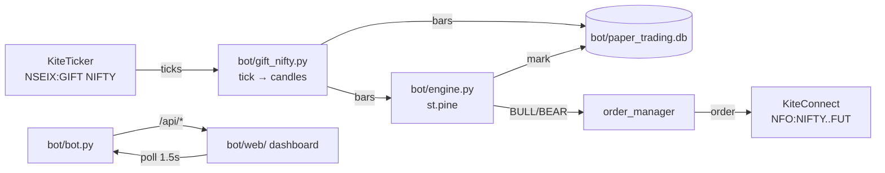

# GIFT Nifty → Nifty Futures execution bot

Single-process algorithmic trading bot for the `Surikbs` Pine strategy
(`bot/st.pine`). The bot subscribes to **GIFT Nifty** ticks, builds candles, evaluates
the Pine conditions itself and trades the **NFO Nifty future**. No TradingView in
the loop.

## Files

| File | Role |
|---|---|
| `bot/bot.py` | **The bot.** Entrypoint: tick feed, engine, mark loop, API, dashboard |
| `bot/gift_nifty.py` | GIFT Nifty instrument resolution, KiteTicker subscription, tick→candle aggregation |
| `bot/engine.py` | Evaluates `bot/st.pine` on GIFT Nifty bars; routes orders to the Nifty future |
| `bot/strategy.py` | The `bot/st.pine` entry filters in Python (PSAR / triple SuperTrend) |
| `bot/order_manager.py` | Validation, margin, sizing, paper/live execution, pause/panic |
| `bot/kite_client.py` | KiteConnect wrapper; quotes, instrument lookup, mocked orders in PAPER |
| `bot/kite_auth.py` | Kite login callback, request-token exchange, and access-token persistence |
| `bot/database.py` | SQLite ledger: account, positions, orders, trades, equity curve, GIFT candles |
| `bot/config.py` | `.env` loading, `EXECUTION_MODE` toggle, all tunables |
| `bot/web/` | Chart-free vanilla-JS dashboard (Tailwind via CDN), served by `bot/bot.py` |
| `tests/` | Focused automated regression tests |

## Architecture



### Signal source ≠ execution venue

This is deliberate, not an oversight:

* **GIFT Nifty is the signal source.** It trades ~20 hours on NSEIX and is the
  standard pre-market proxy for Nifty 50, so it reflects overnight and
  early-morning global moves before NSE opens.
* **GIFT Nifty cannot be traded.** Zerodha staff, Kite Connect forum: *"GIFT
  Nifty is not an index and is not tradeable via Zerodha. It has been placed
  under the non-tradeable indices category."* It is an index row on NSEIX.
* **Execution is the NFO Nifty future**, the front-month contract resolved from
  the expiry calendar by `kite_client.future_symbol`.

### Two clocks

| Window | Behaviour |
|---|---|
| GIFT Nifty session (~20h) | evaluate `st.pine` on every closed bar |
| NSE F&O session (09:15–15:30 IST) | LIVE orders may be placed; PAPER uses available market prices |
| Outside NSE F&O hours | PAPER engine signals may simulate at the completed GIFT candle close; LIVE signals are deferred |

A signal fires only on a fresh BUY/SELL transition after a completed candle.
After-hours PAPER simulation does not force an order when the signal is neutral.
Open PAPER engine positions are marked against the live GIFT Nifty price after
hours; portfolio equity includes current unrealised P/L.
LIVE signals outside the NSE window are recorded as **deferred** and are not
auto-executed at 09:15.

### Warmup, stated plainly

Kite serves **no historical data for NSEIX**, so the bot must build its own
candles from live ticks. RSI and TSV are not entry filters. The remaining longest
indicator is SuperTrend with ATR length 12, so the engine needs 12 closed candles
before its first valid signal (about 60 minutes at `5minute`). After that, it
evaluates each completed candle. Bars are persisted to the `gift_candles` table,
so a restart **resumes** the warmup instead of restarting it.

The first ~60 minutes after a fresh install will not trade because GIFT Nifty
history is unavailable; persisted bars can reduce that wait after a restart.

## Setup

```bash
python -m venv .venv && .venv/bin/pip install -r requirements.txt
test -f bot/.env || cp bot/.env.example bot/.env   # then edit bot/.env
```

Kite credentials are **required**, not optional — the GIFT Nifty feed runs on
`KiteTicker`, so without a token there is no data and no strategy. Set
`KITE_API_KEY` and `KITE_API_SECRET` from https://developers.kite.trade, and
register the Redirect URL as `http://127.0.0.1:9000/zerodha/callback`.

`EXECUTION_MODE=PAPER` still needs a live token: PAPER mocks *orders*, not
market data.

At startup, a valid saved token starts the GIFT Nifty feed automatically. If
the token is missing or expired and Kite credentials are configured, the bot
opens Zerodha login in the local browser. Sign-in and 2FA are still required;
headless deployments must use the dashboard or manual request-token flow.

### Getting the access token

Kite has no username/password API — the token comes from a browser redirect.
The bot handles both halves:

1. Click **Connect to Kite** on the dashboard (or `POST /api/kite/login-url`).
2. Authenticate in the tab that opens. Zerodha redirects to
   `/zerodha/callback`, which exchanges the `request_token` automatically.
3. The token is written back into `bot/.env` so it survives a restart, and the GIFT
   Nifty feed starts immediately.

If the redirect cannot reach the bot, paste the `request_token` from the
redirect URL into the dashboard's manual field (or
`POST /api/kite/session {"request_token": "..."}`).

Tokens expire daily around **06:00 IST**. A stale token is not a crash: the bot
keeps running on persisted candles and the dashboard separates account
authentication from GIFT market-data status. The Kite button redirects in the
current tab to avoid browser popup blocking; after login, use the dashboard's
GIFT reconnect control if authentication succeeds but ticks do not arrive.

| Endpoint | Purpose |
|---|---|
| `GET /api/kite/status` | token health, user, redirect URL |
| `POST /api/kite/login-url` | the URL to open |
| `POST /api/kite/session` | exchange a `request_token` |
| `GET /zerodha/callback` | redirect target; auto-exchanges the token |

## Run

```bash
.venv/bin/python bot/bot.py    # the whole bot on WEBHOOK_HOST:WEBHOOK_PORT
```

Open `http://127.0.0.1:9000/` for the dashboard and `/docs` for the OpenAPI
schema. There is nothing else to start, and no inbound endpoint to expose.

## Run with Docker

Docker Compose keeps the SQLite database in a named volume and mounts
`bot/.env` so a renewed Kite access token survives container restarts. The
dashboard port is published on host loopback only.

```bash
test -f bot/.env || cp bot/.env.example bot/.env
# Edit bot/.env and set the Kite credentials; keep EXECUTION_MODE=PAPER initially.
docker compose up --build -d
docker compose logs -f bot
```

Open `http://127.0.0.1:9000/`. Stop the container with
`docker compose down`; do not add `-v` unless you intend to delete the database
volume.

For a remote VPS, keep the port bound to loopback and use an HTTPS reverse
proxy with authentication. Set `KITE_REDIRECT_URL` in `bot/.env` to the public
HTTPS `/zerodha/callback` URL and register that exact URL in the Kite developer
console. The proxy must forward that callback to port 9000. Do not expose the
unauthenticated dashboard/API directly to the internet.

## API

| Method | Path | Purpose |
|---|---|---|
| `GET` | `/api/status` | mode, uptime, Kite auth, market clock, GIFT feed + engine state |
| `GET` | `/api/portfolio` | balance, margin utilisation, realised/unrealised PnL |
| `GET` | `/api/positions?status=all\|open\|closed` | Nifty futures positions |
| `GET` | `/api/orders?limit=&search=&mode=` | order book from SQLite |
| `GET` | `/api/equity?limit=` | cumulative equity curve |
| `GET` | `/api/trades?limit=&mode=` | settled round trips with fees and net PnL |
| `GET` | `/api/signals?limit=` | engine signal audit trail |
| `POST` | `/api/toggle-mode` | `{"mode":"PAPER\|LIVE","confirm":bool}` |
| `GET` | `/api/kite/status` | Kite token health |
| `POST` | `/api/kite/login-url` | start the Zerodha login |
| `POST` | `/api/kite/session` | exchange a `request_token` |
| `POST` | `/api/kite/feed/reconnect` | restart GIFT market data with a valid token |
| `POST` | `/api/pause` | `{"paused":bool,"reason":str}` |
| `POST` | `/api/panic` | `{"confirm":true,"reason":str}` — squares off and pauses |

Two guards are enforced server-side, not just in the UI: switching to `LIVE`
requires `confirm=true` **and** complete Kite credentials, and `/api/panic`
requires `confirm=true`. Both are rejected with a `4xx` otherwise.

## Dashboard

`bot/web/` is a no-build single-page app: Tailwind from CDN and plain ES2020 in
`bot/web/app.js`. It polls every 1.5 s and patches the DOM in place.

* **Dashboard** — portfolio value, margin available (with utilisation
  bar), active mode pill (green LIVE / amber PAPER), real-time PnL coloured by
  sign, the GIFT Nifty signal engine (verdict, indicator values, which of the
  two entry filters are live, warmup progress), open positions, a Paper/Live
  toggle, pause, and the panic button. Live mode still requires an explicit
  confirmation.
* **Order Logs** — searchable, mode-filtered order book plus the engine signal
  trail (placed / held / deferred and why), with CSV export.
* **Performance & trades** — headline performance stats and the trade ledger.

Polling pauses while the tab is hidden and resumes on focus. If the API goes
away the UI keeps the last values on screen, flags the failure, and recovers on
its own once the server returns.

The frontend is unauthenticated and binds to `WEBHOOK_HOST` (default
`127.0.0.1`). Keep it on loopback, or put it behind an authenticating reverse
proxy before exposing it — anyone who can reach `/api/panic` or
`/api/toggle-mode` can move real money.

There is no inbound endpoint to expose: the bot pulls its own market data. The
GIFT feed pill turns red when ticks stop arriving, so a dead websocket is
visible without tailing logs.

## Tuning

| Setting | Effect |
|---|---|
| `GIFT_CANDLE_INTERVAL` | bar size for the GIFT Nifty series (`5minute`, `15minute`…) |
| `ENGINE_INTERVAL_SECONDS` | how often the engine checks for a closed bar and marks PnL |
| `STRATEGY_*` | the SuperTrend agreement threshold and PSAR parameters |

If you change the timeframe in `st.pine`, change `GIFT_CANDLE_INTERVAL` to match
— the indicators are only meaningful on the timeframe they were tuned for.

## Safety rules

| Rule | Where |
|---|---|
| NSE session only, 09:15–15:30 IST, Mon–Fri | `kite_client.market_status`, enforced in `engine` and `order_manager` |
| LIVE front-month symbol and lot size verified against Kite's NFO instruments | `kite_client.KiteClient.front_month_contract` |
| Duplicate/replayed signals rejected | `order_manager._already_processed` |
| Stale signals rejected (default 300 s) | `order_manager._signal_age_seconds` |
| `MAX_OPEN_LOTS` and `LOT_MARGIN` enforced before every entry | `order_manager._execute_directional` |
| LIVE orders only placed inside the NSE F&O session; after-hours PAPER uses the GIFT close | `engine.StrategyEngine.execute` |
| Unresolved orders and broker/ledger mismatches block further LIVE actions | `order_manager.OrderManager` |
| Panic reports partial or failed square-offs instead of claiming success | `order_manager.OrderManager.square_off` |
| Panic pauses new entries | `order_manager.pause` / `OrderManager.paused` |

### Strategy evaluation

`bot/strategy.py` implements the two entry filters from `bot/st.pine` §12–14
(2-of-3 SuperTrends and PSAR). RSI and TSV are removed. `bot/engine.py` evaluates
each closed GIFT Nifty bar and acts only on a **transition** — `BULL` after not-`BULL`
— mirroring the Pine `not longCondition[1]` guard, so a run of bullish bars
produces exactly one entry.

The engine reports warm-up progress until 12 closed bars are available, then
evaluates every completed candle. The 12-bar minimum is required by the longest
remaining SuperTrend ATR length.

The dashboard's condition checklist shows exactly which of the two are live,
so a quiet bot is explainable rather than mysterious.

Removing RSI and TSV makes signals less selective; evaluate the changed strategy
in paper mode before enabling live orders.

The Pine strategy defines entries but no stop-loss, profit target, or timed
exit. Positions remain open until an opposite entry or manual square-off; the
bot does not automatically close them at the end of the NSE session.

## Tests

```bash
.venv/bin/python -m pytest -q
.venv/bin/python -m compileall -q bot tests
```

The strategy port is exercised with synthetic candle series; `strategy.evaluate`
returns a `StrategyVerdict` whose `.conditions` dict shows which SuperTrend and
PSAR conditions held on the final bar.

Start the bot separately with `.venv/bin/python bot/bot.py`.
