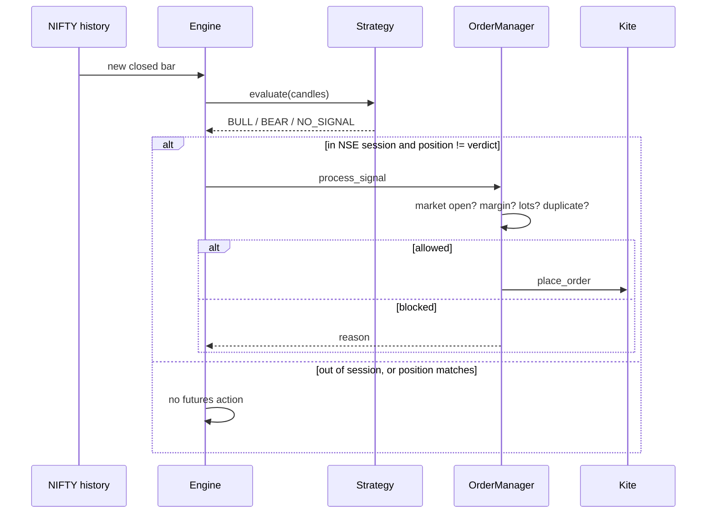

# Architecture

## The split that defines everything

**Signal source ≠ execution venue.**

| | Instrument | Why |
|---|---|---|
| **Signal** | `NSE:NIFTY 50` | The index the Nifty future tracks |
| **Execution** | `NFO` Nifty future (front month, rolled 5 days early) | NIFTY 50 is an index — it cannot be traded |

So Belaku reads NIFTY 50 and trades the future. The contract is resolved from
the expiry calendar by `kite_client.future_symbol`, and switched to the next month
`ROLLOVER_DAYS_BEFORE_EXPIRY` days before expiry. LIVE applies the same window,
but resolves the symbol against Kite's instrument dump
(`kite_client.front_month_symbol`) so it only ever names a contract the broker
lists.

## Components

| File | Role |
|---|---|
| `bot/bot.py` | Entrypoint: engine, mark loop, API, dashboard |
| `bot/bar_source.py` | NIFTY 50 history source and the bar-source protocol |
| `bot/engine.py` | Evaluates the strategy on closed bars; routes orders |
| `bot/strategy.py` | The entry rules in Python (SuperTrend 14×3 + PSAR) |
| `bot/order_manager.py` | Validation, margin, sizing, paper/live execution, pause/panic |
| `bot/kite_client.py` | KiteConnect wrapper; quotes, instruments, market clock |
| `bot/kite_auth.py` | Login callback, token exchange, persistence |
| `bot/market_calendar.py` | NSE holiday calendar |
| `bot/database.py` | SQLite persistence |
| `bot/web/` | No-build single-page dashboard |

## One clock, one session

The signal series and the execution venue keep the same hours, so "the market is
open" has one answer.

| Window | Behaviour |
|---|---|
| NSE session (09:15–15:30 IST) | Evaluate the strategy on every closed bar |
| NSE F&O session (09:15–15:30 IST) | LIVE orders may be placed |
| Outside NSE F&O hours | PAPER may simulate at the future's last price; **LIVE signals are deferred** |

A deferred LIVE signal is **never** auto-executed at 09:15. It is recorded as
deferred and dropped — firing a stale signal into the open is worse than missing
it.

## Market data

The signal series is read from Kite history only: there is no tick subscription
for the index, and a strategy that trades NSE hours needs nothing more — a bar
appears when the exchange closes it. The series is cached per
`HISTORY_REFRESH_SECONDS` so the engine's poll does not turn into one API call
each time.

The execution future's price is polled from the mark loop (every
`ENGINE_INTERVAL_SECONDS`, not per dashboard poll — Kite's quote API is rate
limited).

## Warm-up

The indicators are recursive, so they need history before they mean anything.

The bot loads candles from `kite.historical_data` and treats them as the source
of truth. Entry rules are PSAR and a single 14×3 SuperTrend, which needs **15
closed bars** (longest ATR period + 1) — about 3.75 hours at `15minute`, 15 hours
at `60minute`. A fresh install warms up immediately from Kite history rather than
waiting for bars to accumulate.

## Signal lifecycle

The engine drives the position to the **verdict** — flat and `BULL` opens,
agreeing holds, and opposing closes. A `NO_SIGNAL` bar holds: the exit is the pair
*flipping*, not the pair disagreeing. There is no stop-loss and no profit target,
so a position runs until the trend it was taken on actually reverses. It is not gated on a one-bar transition,
because a signal that arrives while the NSE is shut is deferred rather than
placed, and a transition gate would then treat every later bar as unchanged and
never enter. A run of bullish bars still produces exactly one entry: once the
position is long there is nothing left to do.

The **same rule runs in both modes.** Only the futures leg exists, and it waits
for the session. See [Execution](/execution).

## Why the dashboard is a poll, not a websocket

The bot pulls its own market data; there is no inbound webhook to expose. The
dashboard polls `/api/status` and `/api/portfolio` every 1.5 s and the ledger
endpoints every 5 s. Polling pauses while the tab is hidden.

That is a deliberate simplification: one less protocol, and the failure mode
(stale numbers) is visible rather than silent.

## Next

- [Strategy](/strategy) — the entry rules in detail
- [Execution](/execution) — order path and safety gates
- [Database](/database)
