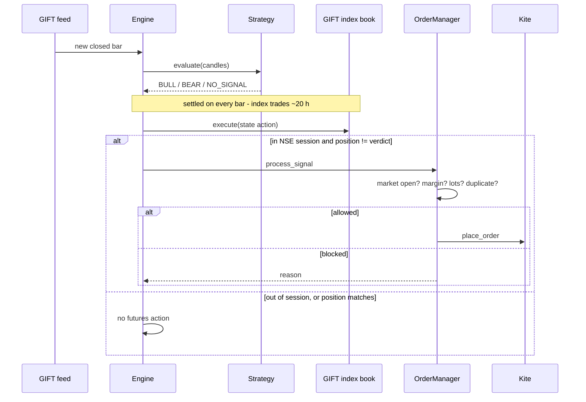

# Architecture

## The split that defines everything

**Signal source ≠ execution venue.**

| | Instrument | Why |
|---|---|---|
| **Signal** | `NSEIX:GIFT NIFTY` | Trades ~20 h/day; the standard pre-market proxy for Nifty 50 |
| **Execution** | `NFO` Nifty future (front month, rolled 5 days early) | GIFT Nifty is an index — it cannot be traded |

Zerodha's own position: *"GIFT Nifty is not an index and is not tradeable via
Zerodha. It has been placed under the non-tradeable indices category."*

So Belaku reads GIFT Nifty and trades the future. The contract is resolved from
the expiry calendar by `kite_client.future_symbol`, and switched to the next month
`ROLLOVER_DAYS_BEFORE_EXPIRY` days before expiry. LIVE applies the same window,
but resolves the symbol against Kite's instrument dump
(`kite_client.front_month_symbol`) so it only ever names a contract the broker
lists.

## Components

| File | Role |
|---|---|
| `bot/bot.py` | Entrypoint: feed, engine, mark loop, API, dashboard |
| `bot/gift_nifty.py` | Instrument resolution, `KiteTicker` subscription, tick → candle, execution-future ticks |
| `bot/engine.py` | Evaluates the strategy on closed bars; routes orders |
| `bot/strategy.py` | The entry rules in Python (SuperTrend 14×3 + PSAR) |
| `bot/order_manager.py` | Validation, margin, sizing, paper/live execution, pause/panic |
| `bot/kite_client.py` | KiteConnect wrapper; quotes, instruments, market clock |
| `bot/kite_auth.py` | Login callback, token exchange, persistence |
| `bot/market_calendar.py` | NSE holiday calendar |
| `bot/database.py` | SQLite persistence |
| `bot/web/` | No-build single-page dashboard |

## Two clocks

This is the part that surprises people. GIFT Nifty and NSE F&O keep different
hours, so "the market is open" has two answers.

| Window | Behaviour |
|---|---|
| GIFT Nifty session (~20 h) | Evaluate the strategy on every closed bar |
| NSE F&O session (09:15–15:30 IST) | LIVE orders may be placed |
| Outside NSE F&O hours | PAPER may simulate at the future's last price; **LIVE signals are deferred** |

A deferred LIVE signal is **never** auto-executed at 09:15. It is recorded as
deferred and dropped — firing a stale signal into the open is worse than missing
it.

## One websocket, two instruments

The execution future's ticks ride the **same** `KiteTicker` socket as GIFT
Nifty, subscribed as a second token. This is not an optimisation: Twisted's
reactor is process-global and one-shot, so a second `KiteTicker` cannot be
created without raising `ReactorNotRestartable` on the first.

That makes tick routing load-bearing. `_handle_ticks` dispatches on
`instrument_token`, and only GIFT ticks reach the candle builder — the two
prices differ by the basis, so a misrouted tick would corrupt the signal series
rather than fail loudly. A tick with no token is treated as GIFT, which keeps
every existing caller and test valid.

If the future's token cannot be resolved, the feed falls back to polling its
quote from the mark loop (every `ENGINE_INTERVAL_SECONDS`, not per dashboard
poll — Kite's quote API is rate limited). The dashboard shows which source is in
use.

## Signal latency

The signal path is event-driven, not polled. When a candle closes the feed sets
`bar_closed` from the tick thread, and the engine wakes on it immediately rather
than waiting for its next poll. The poll (`ENGINE_INTERVAL_SECONDS`) is kept only
as a fallback, for a source that cannot signal (the NIFTY spot book reads REST
history and has no tick subscription) and for a missed wake-up.

A close also sets `history_due`. When Kite history is authoritative the
tick-built bar is discarded in favour of the exchange's own OHLC, so the new bar
only appears after a fetch — and that fetch is normally throttled to
`HISTORY_REFRESH_SECONDS`. The marker forces it past the throttle, so the signal
does not wait 30 s for a refresh the close already made necessary.

Four latencies are measured and shown on the dashboard, not estimated:

| Figure | Measures |
|---|---|
| `detect_ms` | bar close → verdict computed |
| `submit_ms` | verdict → order handed to the broker |
| `ack_ms` | order submission → broker acknowledgement |
| `fill_ms` | submission → fill confirmed |

For a market order `place_order` blocks until the fill is confirmed, so
`submit_ms` covers submission, acknowledgement and fill in one measurement. A
`detect_ms` above one second means the engine missed the close and fell back to
the poll, which the dashboard flags rather than showing as normal.

## Warm-up

The indicators are recursive, so they need history before they mean anything.

Kite **does** serve GIFT Nifty (NSEIX) history, including the overnight session,
so the bot loads candles from `kite.historical_data` and treats them as the
source of truth. Entry rules are PSAR and a single 14×3 SuperTrend, which needs
**15 closed bars** (longest ATR period + 1) — about 75 minutes at `5minute`,
3.75 hours at `15minute`.

Bars are persisted to `gift_candles`, so a restart **resumes** the warm-up
instead of restarting it. A fresh install warms up immediately from Kite history
rather than waiting for ticks to accumulate.

Tick-built candles are used only while history is unavailable, and the feed logs
which source it is on.

## Signal lifecycle

The engine drives the position to the **verdict** — flat and `BULL` opens,
agreeing holds, and opposing closes. A `NO_SIGNAL` bar holds: the exit is the pair
*flipping*, not the pair disagreeing. There is no profit target, so a position
runs until the trend it was taken on actually reverses — or until its protective
stop is hit, which caps a single loss without changing the trend exit. It is not gated on a one-bar transition,
because a signal that arrives while the NSE is shut is deferred rather than
placed, and a transition gate would then treat every later bar as unchanged and
never enter. A run of bullish bars still produces exactly one entry: once the
position is long there is nothing left to do.

The **same rule runs in both books and both modes.** The GIFT index book is
settled first and outside the session gate, because it prices an index that trades
~20 hours and it is the venue comparison the index book exists to make; only the
futures leg waits for the session. See
[Execution](/execution#two-strategies-one-instrument).

## Why the dashboard is a poll, not a websocket

The bot pulls its own market data; there is no inbound webhook to expose. The
dashboard polls `/api/status` and `/api/portfolio` every 1.5 s and the ledger
endpoints every 5 s. Polling pauses while the tab is hidden.

That is a deliberate simplification: one less protocol, and the failure mode
(stale numbers) is visible rather than silent.

## Next

- [Strategy](/strategy) — the entry rules in detail
- [Execution](/execution) — order path and safety gates
- [Database](/database)
