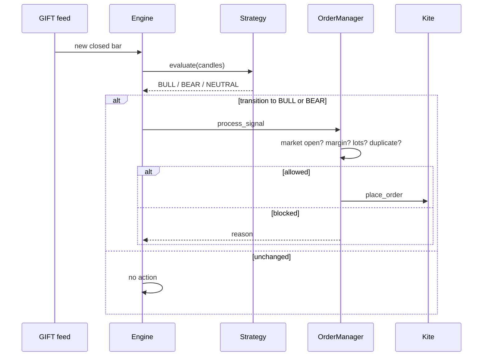

# Architecture

## The split that defines everything

**Signal source ≠ execution venue.**

| | Instrument | Why |
|---|---|---|
| **Signal** | `NSEIX:GIFT NIFTY` | Trades ~20 h/day; the standard pre-market proxy for Nifty 50 |
| **Execution** | `NFO` front-month Nifty future | GIFT Nifty is an index — it cannot be traded |

Zerodha's own position: *"GIFT Nifty is not an index and is not tradeable via
Zerodha. It has been placed under the non-tradeable indices category."*

So Belaku reads GIFT Nifty and trades the future. The front-month contract is
resolved from the expiry calendar by `kite_client.future_symbol`.

## Components

| File | Role |
|---|---|
| `bot/bot.py` | Entrypoint: feed, engine, mark loop, API, dashboard |
| `bot/gift_nifty.py` | Instrument resolution, `KiteTicker` subscription, tick → candle, execution-future ticks |
| `bot/engine.py` | Evaluates the strategy on closed bars; routes orders |
| `bot/strategy.py` | The entry rules in Python (triple SuperTrend + PSAR) |
| `bot/order_manager.py` | Validation, margin, sizing, paper/live execution, pause/panic |
| `bot/kite_client.py` | KiteConnect wrapper; quotes, instruments, market clock |
| `bot/kite_auth.py` | Login callback, token exchange, persistence |
| `bot/market_calendar.py` | NSE holiday calendar |
| `bot/database.py` | SQLite persistence |
| `bot/web/` | No-build single-page dashboard |

## Two clocks

This is the part that surprises people. GIFT Nifty and NSE F&O keep different
hours, so "the market is open" has two answers.

| Window | Behaviour |
|---|---|
| GIFT Nifty session (~20 h) | Evaluate the strategy on every closed bar |
| NSE F&O session (09:15–15:30 IST) | LIVE orders may be placed |
| Outside NSE F&O hours | PAPER may simulate at the completed GIFT close; **LIVE signals are deferred** |

A deferred LIVE signal is **never** auto-executed at 09:15. It is recorded as
deferred and dropped — firing a stale signal into the open is worse than missing
it.

## One websocket, two instruments

The execution future's ticks ride the **same** `KiteTicker` socket as GIFT
Nifty, subscribed as a second token. This is not an optimisation: Twisted's
reactor is process-global and one-shot, so a second `KiteTicker` cannot be
created without raising `ReactorNotRestartable` on the first.

That makes tick routing load-bearing. `_handle_ticks` dispatches on
`instrument_token`, and only GIFT ticks reach the candle builder — the two
prices differ by the basis, so a misrouted tick would corrupt the signal series
rather than fail loudly. A tick with no token is treated as GIFT, which keeps
every existing caller and test valid.

If the future's token cannot be resolved, the feed falls back to polling its
quote from the mark loop (every `ENGINE_INTERVAL_SECONDS`, not per dashboard
poll — Kite's quote API is rate limited). The dashboard shows which source is in
use.

## Warm-up

The indicators are recursive, so they need history before they mean anything.

Kite **does** serve GIFT Nifty (NSEIX) history, including the overnight session,
so the bot loads candles from `kite.historical_data` and treats them as the
source of truth. Entry rules are PSAR and 2-of-3 SuperTrend, which needs **14
closed bars** (longest ATR period + 1) — about 70 minutes at `5minute`,
3.5 hours at `15minute`.

Bars are persisted to `gift_candles`, so a restart **resumes** the warm-up
instead of restarting it. A fresh install warms up immediately from Kite history
rather than waiting for ticks to accumulate.

Tick-built candles are used only while history is unavailable, and the feed logs
which source it is on.

## Signal lifecycle

The engine acts only on a **transition** — `BULL` after not-`BULL` — mirroring
the Pine `not longCondition[1]` guard. A run of bullish bars produces exactly one
entry.

## Why the dashboard is a poll, not a websocket

The bot pulls its own market data; there is no inbound webhook to expose. The
dashboard polls `/api/status` and `/api/portfolio` every 1.5 s and the ledger
endpoints every 5 s. Polling pauses while the tab is hidden.

That is a deliberate simplification: one less protocol, and the failure mode
(stale numbers) is visible rather than silent.

## Next

- [Strategy](/strategy) — the entry rules in detail
- [Execution](/execution) — order path and safety gates
- [Database](/database)
