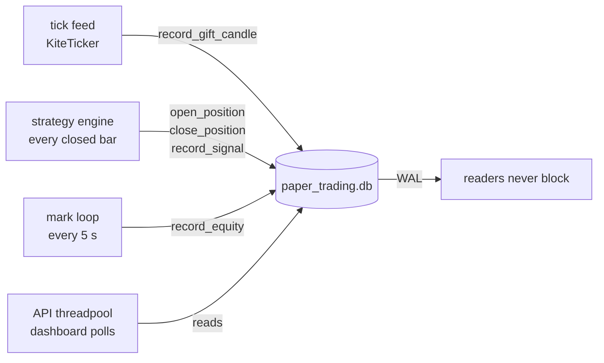

# Database

Belaku persists everything it needs to survive a restart in a single SQLite
file. There is no server to run, no migration tool, and no ORM — just
`sqlite3` from the standard library and one schema string in
[`bot/database.py`](https://github.com/surikbs-xp/belaku/blob/main/bot/database.py).

That choice is deliberate. The bot is a single process on a single box, writing
a few rows per minute. A database server would add an operational dependency
without buying anything.

## Why SQLite, and what it costs

| Property | Consequence |
|---|---|
| Single file | Backup is `cp`. Reset is `rm`. Nothing to provision. |
| WAL journal | Readers never block the writer, so the API can serve the dashboard while the engine writes. |
| `BEGIN IMMEDIATE` | Every write takes the write lock up front, so two threads cannot deadlock mid-transaction. |
| 5 s busy timeout | A contended write waits instead of failing with `database is locked`. |
| One writer at a time | Fine here: writes are a few per minute, not per second. |

The trade-off is concurrency. SQLite allows exactly one writer, so the design
keeps write transactions short and never holds one open across a network call.
If you ever needed multiple bot instances on one database, this is the part that
would have to change.

## Where the file lives

The path comes from `DB_PATH`:

| Context | Path | Why |
|---|---|---|
| Local (`python bot.py`) | `bot/paper_trading.db` | Default from `config.py` |
| Docker | `/data/paper_trading.db` | On the `bot-data` volume, so it survives `docker compose down` |

:::warning[The image is read-only]
`compose.yaml` sets `read_only: true` and drops all capabilities. The
database **must** live on the mounted volume — a path inside the image
cannot be written.
:::


## The four threads that touch it



All four share one file. WAL mode is what makes that safe: the mark loop can
append an equity sample while the dashboard reads the trade ledger.

## What is stored, and why

| Table | Written by | Purpose |
|---|---|---|
| `account` | `close_position`, `adjust_balance` | Single row: starting and current balance |
| `positions` | `open_position`, `close_position` | Open and closed positions, with `position_key` for direction |
| `orders` | `record_order` | Every order attempt, including rejected ones |
| `trades` | `close_position` | One row per closed trade — the ledger |
| `equity_curve` | `record_equity` | Mark-to-market samples for drawdown and the equity chart |
| `signals` | `record_signal` | Every strategy verdict, accepted or blocked, with the reason |
| `gift_candles` | `record_gift_candle` | GIFT Nifty bars, so warm-up survives a restart |
| `trade_notes` | `save_trade_note` | Human-written journal, keyed by trade id |

Two of these deserve emphasis:

**`gift_candles` is why a restart is cheap.** The indicators are recursive, so
they need history. Without this table the bot would re-accumulate its warm-up
from scratch after every restart — about 70 minutes at `5minute`. Instead it
loads the persisted bars and is immediately ready.

**`signals` records refusals, not just successes.** A quiet bot is the hardest
thing to debug in trading. Storing the rejected verdict *and its reason* is what
lets the dashboard answer "why didn't it trade?" instead of leaving you to guess.

## Money and time

**Money is `REAL`.** SQLite has no `DECIMAL`, so prices and PnL are IEEE-754
doubles. For a single account this is fine — the values are rounded for display
and never accumulated into a balance that must reconcile to the paisa. If you
ever needed exact accounting, this is the decision to revisit.

**Quantities are `INTEGER`.** Lots × lot size, always whole.

**Timestamps are ISO-8601 text in IST**, e.g. `2026-11-06T23:35:00+05:30`.
Text sorts chronologically, which is why `ORDER BY ts` works, and the offset
makes the timezone explicit rather than implied.

## Direction is a column, not a sign

`positions.position_key` is `+1` for long and `-1` for short, enforced by a
`CHECK` constraint. `quantity` is always positive.

This matters because an opposite signal must **close** the existing position,
not stack a new one. With a signed quantity you would have to infer intent from
arithmetic; with an explicit key the rule is readable:

```python
gross = (exit_price - entry_price) * quantity * position_key
```

One formula, both directions, no branching.

## Schema changes

There is no migration framework. `init_db()` runs `CREATE TABLE IF NOT EXISTS`
on every connection, so a new table appears automatically. A new *column* on an
existing table needs an explicit `ALTER TABLE`, guarded by a `PRAGMA table_info`
check — see the `partial` column on `gift_candles` for the pattern:

```python
columns = {row[1] for row in conn.execute("PRAGMA table_info(gift_candles)")}
if "partial" not in columns:
    conn.execute("ALTER TABLE gift_candles ADD COLUMN partial INTEGER NOT NULL DEFAULT 0")
```

This is enough for a single-deployment bot. It is not enough for a schema you
would need to roll back.

## Next

- [Schema reference](/database/schema) — every table, column and index
- [Operations](/database/operations) — backup, reset, inspecting, troubleshooting
