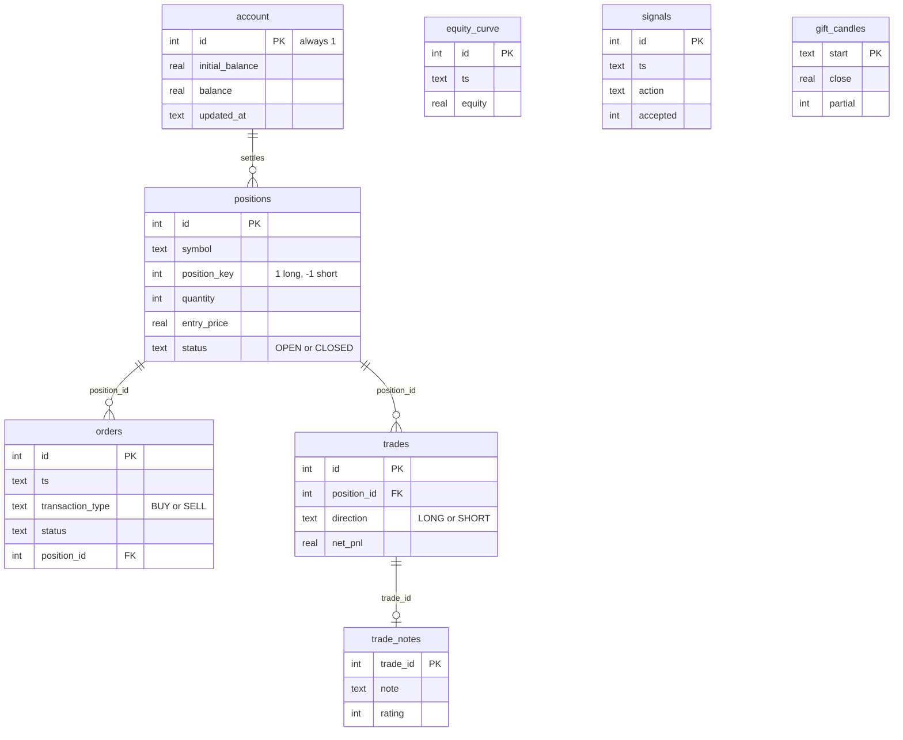

# Schema reference

Every table, column and index in `bot/database.py`. The schema is created by
`init_db()` on first connection, so a fresh `DB_PATH` needs no setup step.

## Entity relationships

`equity_curve`, `signals` and `gift_candles` are standalone — they are event
logs, not part of the position graph.

---

## `account`

Exactly one row, enforced by `CHECK (id = 1)`. A single-row table is how the
schema expresses "there is one account" without a separate config file.

| Column | Type | Notes |
|---|---|---|
| `id` | INTEGER PK | Always `1` |
| `initial_balance` | REAL | Starting capital; the denominator for total return |
| `balance` | REAL | Current realised balance, moved by `close_position` |
| `updated_at` | TEXT | ISO-8601 IST |

`balance` excludes unrealised PnL. Equity is `balance + unrealised`, computed on
read — never stored, so it cannot drift from the positions it derives from.

---

## `positions`

One row per position, open or closed. A partial close reduces `quantity` and
leaves the row `OPEN`; a full close flips `status` to `CLOSED`.

| Column | Type | Notes |
|---|---|---|
| `id` | INTEGER PK | |
| `symbol` | TEXT | e.g. `NIFTY26KFUT` |
| `position_key` | INTEGER | `+1` long, `-1` short. `CHECK IN (1, -1)` |
| `quantity` | INTEGER | Always positive; direction lives in `position_key` |
| `entry_price` | REAL | |
| `entry_time` | TEXT | ISO-8601 IST |
| `last_price` | REAL | Last mark, updated by the mark loop |
| `sl_price` | REAL | Reserved; the strategy has no stop-loss |
| `trailing_stop` | REAL | Reserved |
| `status` | TEXT | `OPEN` or `CLOSED`. `CHECK` constrained |
| `exit_price` | REAL | Set on full close |
| `exit_time` | TEXT | Set on full close |
| `realized_pnl` | REAL | Accumulates across partial closes |
| `fees` | REAL | Accumulates across partial closes |
| `mode` | TEXT | `PAPER` or `LIVE` |
| `source` | TEXT | `ENGINE` (strategy) or `WEBHOOK` (manual) |
| `strategy` | TEXT | Which strategy opened it |
| `notes` | TEXT | Free text |

**Index:** `idx_positions_status (status, symbol)` — every read filters on
`status = 'OPEN'`, so this is the hot path.

:::note[Why `position_key` instead of a signed quantity]
An opposite signal must close the existing position rather than stack a new
one. An explicit key makes that a comparison, not an inference. See
[the overview](/database#direction-is-a-column-not-a-sign).
:::

---

## `orders`

Every order attempt, including ones that never reached the exchange. This is the
audit trail: if the bot decided to trade, there is a row here saying so.

| Column | Type | Notes |
|---|---|---|
| `id` | INTEGER PK | |
| `ts` | TEXT | ISO-8601 IST |
| `symbol` | TEXT | |
| `transaction_type` | TEXT | `BUY` or `SELL`. `CHECK` constrained |
| `quantity` | INTEGER | |
| `price` | REAL | Nullable for market orders |
| `order_type` | TEXT | `MARKET` or `LIMIT` |
| `product` | TEXT | `NRML`, `MIS`, … |
| `status` | TEXT | `COMPLETE`, `REJECTED`, `PENDING`, … |
| `mode` | TEXT | `PAPER` or `LIVE` |
| `source` | TEXT | `ENGINE` or `WEBHOOK` |
| `exchange_order_id` | TEXT | Kite's id, when it reached the exchange |
| `position_id` | INTEGER | Links to `positions.id` |
| `message` | TEXT | Rejection reason or broker message |

**Index:** `idx_orders_ts (ts DESC)` — the dashboard reads newest-first.

---

## `trades`

The ledger. One row per closed trade, written by `close_position` in the same
transaction that settles the balance — so the ledger and the balance cannot
disagree.

| Column | Type | Notes |
|---|---|---|
| `id` | INTEGER PK | |
| `position_id` | INTEGER | Links to `positions.id` |
| `symbol` | TEXT | |
| `direction` | TEXT | `LONG` or `SHORT`. `CHECK` constrained |
| `quantity` | INTEGER | Quantity actually closed |
| `entry_price` | REAL | |
| `exit_price` | REAL | |
| `entry_time` | TEXT | |
| `exit_time` | TEXT | |
| `gross_pnl` | REAL | Before fees |
| `fees` | REAL | |
| `net_pnl` | REAL | `gross_pnl - fees`; what the balance moved by |
| `mode` | TEXT | `PAPER` or `LIVE` |
| `exit_reason` | TEXT | `SIGNAL`, `MANUAL`, `PANIC`, … |

**Index:** `idx_trades_exit_time (exit_time DESC)`.

A partial close writes **one trade row per close event**, all sharing the same
`position_id`. So `trades` can have more rows than `positions`.

---

## `equity_curve`

Mark-to-market samples, appended by the mark loop every `ENGINE_INTERVAL_SECONDS`
(5 s by default). This is the only table that grows continuously.

| Column | Type | Notes |
|---|---|---|
| `id` | INTEGER PK | |
| `ts` | TEXT | ISO-8601 IST |
| `equity` | REAL | `balance + unrealised` at that moment |
| `balance` | REAL | Realised balance at that moment |
| `unrealized_pnl` | REAL | |

No index. Reads are either "the whole curve" or an aggregate, and at ~17k rows
per day a full scan is still sub-millisecond.

:::warning[This table grows without bound]
At 5 s intervals that is **17,280 rows/day**, ~6.3 M rows/year. It is the
one table you will eventually want to prune. See
[Operations](/database/operations#pruning-the-equity-curve).
:::

`get_equity_summary()` computes drawdown in SQL with a window function rather
than loading the curve into Python — that change took the mark tick from 15.7 ms
to 8.6 ms.

---

## `signals`

Every strategy verdict, whether or not it became an order.

| Column | Type | Notes |
|---|---|---|
| `id` | INTEGER PK | |
| `ts` | TEXT | ISO-8601 IST |
| `action` | TEXT | `BULL`, `BEAR`, `NEUTRAL`, `FLAT`, `PANIC` |
| `payload` | TEXT | JSON: the indicator values behind the verdict |
| `accepted` | INTEGER | `1` accepted, `0` blocked |
| `reason` | TEXT | Why it was blocked, when it was |

**Index:** `idx_signals_ts (ts DESC)`.

This table is the answer to "why didn't it trade?". A `NEUTRAL` verdict with
`accepted = 0` and a reason is a complete explanation, and it is the reason this
table exists at all.

---

## `gift_candles`

GIFT Nifty OHLC bars. Kite history is the source of truth; tick-built bars are a
fallback. Persisting them is what makes a restart cheap.

| Column | Type | Notes |
|---|---|---|
| `start` | TEXT PK | Bucket start, ISO-8601 IST. Primary key gives idempotent upsert |
| `open` | REAL | |
| `high` | REAL | |
| `low` | REAL | |
| `close` | REAL | |
| `volume` | REAL | |
| `ticks` | INTEGER | Ticks observed in the bar |
| `created_at` | TEXT | When the row was written |
| `partial` | INTEGER | `0` complete, `1` missing ticks, `2` cut off by shutdown |

**Index:** `idx_gift_candles_start (start DESC)`.

`start` as the primary key is what makes `record_gift_candle` an idempotent
upsert — the same bar can be written repeatedly (tick updates, then Kite
history) without duplicating.

The `partial` flag exists because the indicators are recursive: one bar with a
hole skews every later value until it washes out. Recording *why* a bar is
suspect lets the feed exclude it rather than silently trusting it.

---

## `trade_notes`

The human half of the record. One row per trade, keyed by `trade_id`.

| Column | Type | Notes |
|---|---|---|
| `trade_id` | INTEGER PK | Links to `trades.id` |
| `note` | TEXT | Free text |
| `setup` | TEXT | Named setup |
| `tags` | TEXT | Comma-separated |
| `rating` | INTEGER | Nullable |
| `mistakes` | TEXT | |
| `updated_at` | TEXT | |

Kept separate from `trades` so the ledger stays machine-written and the journal
stays human-written. A `DELETE` here never touches the ledger.

:::note[Currently unused by the UI]
The journal endpoints (`/api/journal`) and this table are functional but the
dashboard no longer surfaces them. The data model is kept because the
endpoints are still served.
:::

---

## Index summary

| Index | Table | Columns | Serves |
|---|---|---|---|
| `idx_positions_status` | `positions` | `(status, symbol)` | Every open-position read |
| `idx_orders_ts` | `orders` | `(ts DESC)` | Newest-first order list |
| `idx_trades_exit_time` | `trades` | `(exit_time DESC)` | Newest-first ledger |
| `idx_signals_ts` | `signals` | `(ts DESC)` | Newest-first signal list |
| `idx_gift_candles_start` | `gift_candles` | `(start DESC)` | Warm-up load |

`equity_curve` and `trade_notes` have no secondary index: one is scanned
wholesale, the other is read by primary key.
