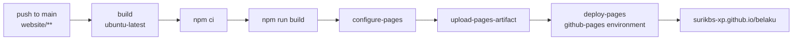

# Docs site

This documentation is a Docusaurus site in `website/`, published to GitHub
Pages at **[surikbs-xp.github.io/belaku](https://surikbs-xp.github.io/belaku/)**.

## How it deploys

`.github/workflows/deploy-docs.yml` runs on every push to `main` that touches
`website/**`, and on demand via **Actions → Deploy docs → Run workflow**.



Two things about this workflow are deliberate and easy to get wrong:

**It runs on `ubuntu-latest`, not a self-hosted runner.** A self-hosted runner
executes on whatever machine you registered — so the docs build would be tied to
that machine being awake, and it needs a GitHub token with `pages: write` and
OIDC, which the default `GITHUB_TOKEN` reliably gets on a GitHub-hosted runner.

**`configure-pages` runs with `enablement: true`.** Without it a first run fails
with `Get Pages site failed ... Not Found` when Pages has never been turned on
for the repository. With it, the first successful run enables Pages itself.

## One-time repository setting

Pages must be switched to **GitHub Actions** as its source, not a branch:

**Settings → Pages → Build and deployment → Source → GitHub Actions**

Using `enablement: true` in the workflow can do this for you, but check it
anyway — if the source is still "Deploy from a branch", the artifact uploaded by
`upload-pages-artifact` is never published.

## Building locally

```bash
cd website
npm ci          # first time only
npm start       # dev server with hot reload on http://localhost:3000
npm run build   # production build into website/build
npm run serve   # preview the production build
```

The build is strict: `onBrokenLinks: 'throw'` and
`onBrokenMarkdownLinks: 'throw'` in `docusaurus.config.ts`. A typo'd internal
link fails the workflow instead of shipping.

## Adding a page

1. Add the Markdown file under `website/docs/`.
2. Register it in `website/sidebars.ts` — an unregistered file still builds
   but is unreachable from the sidebar.
3. Cross-link with a root-relative path, e.g. `[Running](/running)`.

:::note[`baseUrl` is `/belaku/`]
Absolute asset paths must include it. Use `useBaseUrl()` or a root-relative
link rather than a hardcoded `/img/...`.
:::
