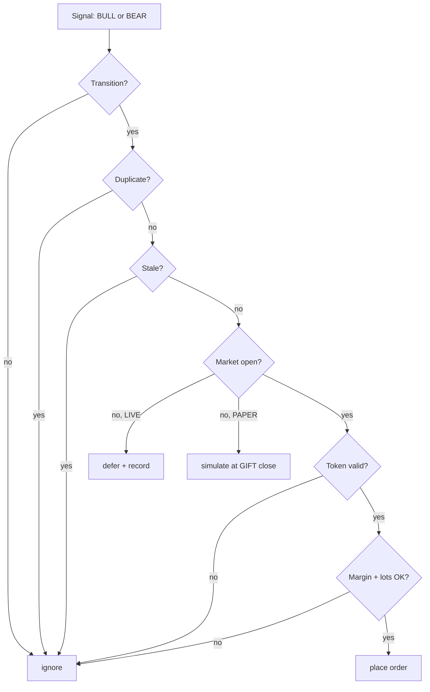

# Execution

What happens between a signal and a fill, and every gate that can stop it.

## The path

## Safety gates

Every one of these is enforced server-side, not just in the UI.

| Gate | Where | Behaviour |
|---|---|---|
| NSE session only, 09:15–15:30 IST Mon–Fri | `kite_client.market_status` | LIVE orders blocked outside; holiday-aware |
| Holiday calendar | `market_calendar` | NSE F&O closures block LIVE |
| Front-month symbol + lot size verified | `kite_client.front_month_contract` | Rejects an unverified contract |
| Duplicate/replayed signals | `order_manager._already_processed` | Rejected |

A signal is stamped with the **close** of the bar that produced it, so it reaches
the broker already one bar old. The staleness limit is therefore derived from
`GIFT_CANDLE_INTERVAL` - one and a half bars, floored at 300 s - rather than
fixed. A fixed 300 s limit rejected the engine's own fresh signals once the
timeframe moved to 15 minutes, because they arrive around 13 minutes old.
| Stale signals (1.5 bars, min 300 s) | `order_manager._signal_age_seconds` | Rejected |
| `MAX_OPEN_LOTS` and `LOT_MARGIN` | `order_manager._execute_directional` | Entry refused |
| Real exchange margin | `kite_client.required_margin` | Uses Kite's basket margin API |
| Token validity | `kite_client.session_status` | LIVE entries blocked when expired |
| Broker/ledger mismatch | `order_manager._live_sync_state` | Blocks further LIVE actions |
| Panic pauses entries | `order_manager.pause` | |

## PAPER vs LIVE

| | PAPER | LIVE |
|---|---|---|
| Market data | Real (Kite) | Real (Kite) |
| Orders | Simulated locally | Sent to Zerodha |
| After hours | Simulates at the completed GIFT close | Defers, never auto-executes |
| Positions | Isolated by `mode` column | Isolated by `mode` column |
| Requires token | **Yes** | Yes |
| Requires confirmation | No | Yes, `confirm=true` |

PAPER mocks *orders*, not market data. The strategy runs identically in both
modes — only execution differs.

## Why LIVE defers instead of queueing

GIFT Nifty trades ~20 hours; NSE F&O trades 6 h 15 m. A signal that fires at
02:00 has no venue until 09:15.

Belaku records it as **deferred** and drops it. It is not queued for the open.
A signal computed on a 02:00 bar is not a signal at 09:15 — the market has moved
and the premise is gone. Firing it late would be worse than missing it.

## Margin

LIVE uses Kite's `basket_order_margins`, which accounts for SPAN, exposure and
any benefit from existing positions. When the API cannot answer, the check falls
back to the static `LOT_MARGIN` estimate and **reports it as an estimate** rather
than silently treating a guess as fact.

## Panic

`POST /api/panic` with `{"confirm": true}` squares off and pauses. It reports
partial or failed square-offs honestly instead of claiming success — a panic
button that lies is worse than no panic button.

## Next

- [Configuration](/configuration) — the knobs
- [API](/api) — the endpoints
