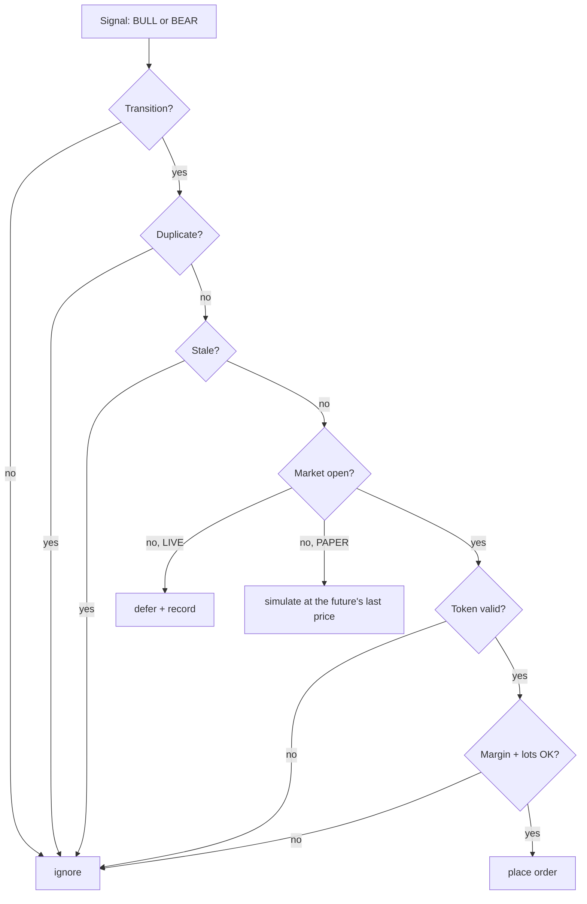

# Execution

What happens between a signal and a fill, and every gate that can stop it.

## The path

## Safety gates

Every one of these is enforced server-side, not just in the UI.

| Gate | Where | Behaviour |
|---|---|---|
| NSE session only, 09:15–15:30 IST Mon–Fri | `kite_client.market_status` | **Both PAPER and LIVE** entries blocked outside; holiday-aware |
| Holiday calendar | `market_calendar` | NSE F&O closures block both modes |
| Front-month symbol + lot size verified | `kite_client.front_month_contract` | Rejects an unverified contract |
| Duplicate/replayed signals | `order_manager._already_processed` | Rejected |
| Stale signals (1.5 bars, min 300 s) | `order_manager._signal_age_seconds` | Rejected |
| `MAX_OPEN_LOTS` and `LOT_MARGIN` | `order_manager._execute_directional` | Entry refused |
| Real exchange margin | `kite_client.required_margin` | Uses Kite's basket margin API |
| Token validity | `kite_client.session_status` | LIVE entries blocked when expired |
| Broker/ledger mismatch | `order_manager._live_sync_state` | Blocks further LIVE actions |
| Panic pauses entries | `order_manager.pause` | |

A signal is stamped with the **close** of the bar that produced it, so it reaches
the broker already one bar old. The staleness limit is therefore derived from
`GIFT_CANDLE_INTERVAL` - one and a half bars, floored at 300 s - rather than
fixed. A fixed 300 s limit rejected the engine's own fresh signals once the
timeframe moved to 15 minutes, because they arrive around 13 minutes old.

## PAPER vs LIVE

| | PAPER | LIVE |
|---|---|---|
| Market data | Real (Kite) | Real (Kite) |
| Signal | Each book's own series, closed bar | Each book's own series, closed bar |
| Orders | Simulated locally | Sent to Zerodha |
| Instrument traded | The Nifty future | The Nifty future |
| Fills | The future's own last price | The broker's fill |
| Outside NSE hours | Refused, never simulated | Refused, never auto-executes |
| Contract selection | Expiry calendar | Kite's instrument dump, same 5-day window |
| Marked at | The future's own last price | The future's own last price |
| Positions | Isolated by `mode` column | Isolated by `mode` column |
| Requires token | **Yes** | Yes |
| Requires confirmation | No | Yes, `confirm=true` |

PAPER mocks *orders*, not market data. The strategy runs identically in both
modes — only execution differs.

Both strategies execute on the **NIFTY future**; only the signal series differs.
GIFT NIFTY 15m reads the GIFT NIFTY index and NIFTY 60m reads the NIFTY spot
index, and each settles its own book on its own closed bar. GIFT NIFTY is a
non-tradeable index, so it is a signal source only — the only thing ever ordered
is the future. Both books roll to the next contract
`ROLLOVER_DAYS_BEFORE_EXPIRY` days before expiry, so the same signal names the
same contract in either mode.

### The strategy is mode-independent by construction

`strategy` and `risk` never read the execution mode. The same candles produce the
same verdicts, the same `fresh` transitions and the same stop levels whichever
book is trading — there is no branch that could make the two modes disagree about
what a signal is. A regression test asserts this directly by evaluating one series
under both modes and comparing every verdict.

What *is* per-mode is the bookkeeping around the rules, and it is reset on every
mode switch:

| State | Why it cannot cross |
|---|---|
| `_last_bar_at` | The "already evaluated this bar" guard. Carried over, the new mode's first bar looks seen and its signal is lost. |
| `_skip_entry_once` | The "do not reverse on the exit candle" latch. It belongs to the exit that set it. |
| `_overnight_pending` | Arms the open reconcile. Set in PAPER it would fire a reconcile on the LIVE book. |
| owed-entry latch | Persisted, so without clearing it a PAPER signal fills as a real order. |

Clearing them makes the switch a clean start: the new mode evaluates its own first
bar and needs its own fresh signal, exactly as a restart does. Open positions are
untouched and are closed by the next opposite signal, so this is safe to call while
trading.

### Where the modes deliberately differ

Two differences are intentional and are not strategy differences:

- **Hours.** PAPER simulates after hours at the future's last price; LIVE defers
  and never auto-executes. A signal computed on a 02:00 bar is not a signal at
  09:15, so LIVE does not replay it — see
  [Why LIVE defers](#why-live-defers-instead-of-queueing).
- **Safety gates.** LIVE additionally requires a valid Kite session, a clean
  broker-position reconciliation and real margin. These protect real money and do
  not change what the strategy decides.

`GET /api/live/readiness` is the pre-flight gate for arming LIVE. It evaluates
**before** the switch — including the broker-vs-ledger reconciliation, which is
the precondition that actually protects real money — so `ready: false` while still
in PAPER means arming would be unsafe.

Because the gate runs before the switch, the reconciliation has to read the
broker while the client is still in PAPER. `KiteClient.positions()` and
`net_position()` therefore take a `force` flag: without it they short-circuit in
PAPER (the trading path must never touch the broker's book), and with it they
read the real figures. Only the two reconciliation paths pass `force=True`. A
gate that could not read the broker until LIVE was already on would be no gate at
all — it would report `position_sync: false` forever and block the very switch it
exists to permit.

:::caution[A signal that arrives while the market is shut is held, and the position is decided on the first in-session bar]

Orders are placed only inside the NSE session, so a signal that fires outside it
is **held**: recorded, and deliberately not retried. The position decision is
therefore taken on the first bar that closes in-session, not on the overnight bar.

**That first bar is the 09:00 GIFT candle, which closes at exactly 09:15** — the
NSE open — so the decision is the morning's own state rather than the overnight
one. The 08:45 candle (closing 09:00) is deliberately *not* used; acting on it
would decide on the overnight state.

The engine drives the position to the **verdict** the indicators are in now, and
the rule is three-way:

| Position | Verdict | What happens |
|---|---|---|
| Flat | BULL / BEAR | **Enter** that side |
| Positioned | agrees | **Hold** — it is already where the indicators point |
| Positioned | opposes | **Exit** — close the whole position |
| Positioned | NO_SIGNAL | **Hold** — the pair disagreeing is not an exit |

**The pair flipping against the position is the only exit.** There is no profit
target and no stop-loss, so a position is held until SuperTrend and PSAR turn the
other way. The exit is a transition too, so a run of opposite bars is one exit
rather than one per bar.

A `NO_SIGNAL` bar is *held*, not closed. The pair disagreeing says nothing about
a position already on, and cutting there exits trades that were merely pausing.
The flip exit has the better payoff ratio, which is why it is the default; over
three years of real bars neither rule is profitable after charges. See
[Backtesting](./backtesting.md).

An exit the broker does not confirm is **retried on the next bar**, never reported
as done. Until it confirms, the engine refuses the entry the same bar would
otherwise have taken — falling through would *reverse* into the new direction on
the bar of an exit that never happened.

Because it asserts a state rather than reacting to a one-bar change, the entry is
self-healing: a BULL verdict that closes after hours is deferred, but the next
in-session bar whose verdict is still BULL opens the position. Under a
transition-gated entry that bar looked like "no signal change" and the bot stayed
flat however long the signal persisted.

On a **restart** the first evaluated bar only primes rather than opening, so
booting into an open market does not trade a verdict the process has not itself
observed. A position that *opposes* the verdict is the exception — it is already
wrong, so it is corrected on that first bar.

Three things to be aware of:

- **A deferred signal is not queued.** The bar that carried it is held and the
  position is decided on the morning's own bar; the overnight verdict is not
  replayed.
- **If the close fails, no new leg is opened.** Opening the other side while the
  old leg is still live would be the double exposure the order manager refuses
  everywhere else.
- **The overnight decision is taken once per session.** It runs on the first
  in-session bar, not on every poll.

Nothing else closes a position overnight: there is no end-of-day flatten and no
stop-loss. The only automatic exit is the pair flipping, and that is evaluated
on a **closed bar** rather than on a mark, so it cannot fire on a stale price. An
expiry is the other case the bot acts on — a contract that has stopped trading
blocks new entries, and any exit signal or PANIC squares off the leg
(`square_off` has no session guard of its own).
:::

## Why LIVE defers instead of queueing

GIFT Nifty trades ~20 hours; NSE F&O trades 6 h 15 m. A signal that fires at
02:00 has no venue until 09:15.

Belaku records it as **deferred** and drops it. It is not queued for the open.
A signal computed on a 02:00 bar is not a signal at 09:15 — the market has moved
and the premise is gone. Firing it late would be worse than missing it.

That reasoning is why the open reconcile does **not** replay the stored action. It
re-reads the verdict the indicators are in *now* and acts only on the
disagreement with the open position, which is a statement about the present
rather than a stale intent.

The *entry* is handled differently, because dropping it outright would leave the
bot flat while the indicators point. A transition that closes out-of-session is
**latched** as an owed entry and honoured on the first bar that can fill it. The
latch is written to the ledger, so a restart between the signal and the open
resumes the same intent instead of forgetting it. It is cleared when the entry
fills, or when a flip exit closes the trade it belonged to — never merely because
a bar went by.

The reconcile closes an opposing overnight leg unconditionally, but only *opens*
the opposite side on a fresh signal. A leg that is against an existing state is
closed and the bot goes flat: reversing on a signal that has been in force all
night is exactly the re-entry the transition rule forbids.

## Two strategies, one instrument

Both strategies execute on the **NIFTY future**. Only the signal series and the
timeframe differ:

| | GIFT NIFTY 15m | NIFTY 60m |
|---|---|---|
| Signal series | `NSEIX:GIFT NIFTY` | `NSE:NIFTY 50` |
| Timeframe | 15 minutes | 60 minutes |
| Execution | `NFO:NIFTY…FUT` | `NFO:NIFTY…FUT` |
| Exit rule | `flat` — closes on the first `NO_SIGNAL` | `flip` — holds through `NO_SIGNAL` |
| Stop-loss | none | none |
| Modes | PAPER or LIVE | PAPER or LIVE |

GIFT NIFTY is a non-tradeable index, so it is a **signal source only** — the only
thing ever ordered is the future. Both books follow the same state rule on their
own closed bars:

| | Both books |
|---|---|
| Flat + BULL/BEAR | Enter, if in session |
| Agrees with the position | Hold |
| Opposes the position | Flip |
| `NO_SIGNAL` | GIFT 15m exits; NIFTY 60m holds |

Each book is settled independently, on its own series and its own bar close, and
each keeps its own position, orders, P&L and stop state. Because both trade the
same contract, positions are **virtual per strategy** and reconciled against the
broker's net position — squaring off one book can never close the other's leg.

Both books act only inside the NSE session. GIFT NIFTY quotes outside it, but the
GIFT 15m strategy must not generate or execute a trade outside the permitted
session, and neither may the NIFTY 60m strategy.

:::note[The futures book is filled and marked from the future only]
An after-hours PAPER entry used to be both priced and marked from the GIFT Nifty
level, because that was the only quote available once NSE had shut. That went
wrong in two directions.

The *mark* kept moving after the close on an index that still ticks, so the book
could show a gain the contract it holds could not have produced. Removing that
left the *fill* still coming from the index while the mark came from the future —
so a position opened after hours carried the index/future **basis** into its P&L
from the first tick, showing a loss no trade had produced.

Both are now the future's own price: the fill from its last quote, the mark from
its last price. Entry and mark therefore share one instrument, and the row only
ever reports what the position itself did. A completed GIFT candle is still what
*authorises* an after-hours entry, but it no longer prices one.

The one thing this costs: if the future has no quote at all, an after-hours entry
is refused rather than filled at the index level. That is deliberate. A paper
entry at a price the contract never traded at is worse than no entry, because it
books a P&L that could never have been realised.
:::

:::note[The paper futures fill walks the order book]

A real market order does not fill at "last price minus a tick" — it lifts the
ask (for a BUY) or hits the bid (for a SELL), starting at the best level. The
paper futures leg now models that:

- When Kite's quote carries **market depth** (the five-level `depth.buy` /
  `depth.sell`), the fill is the **volume-weighted price across the levels the
  order consumed** — normally the best touch for a one-to-four-lot NIFTY order,
  and worse only when a larger order eats into deeper levels.
- When the visible book cannot cover the full order, it is a **partial fill**:
  only the shown quantity is booked, and the remainder is reported honestly
  rather than priced from liquidity that was not displayed.
- When the quote has **no depth**, the fill falls back to the same adverse-tick
  approximation as before (`SLIPPAGE_TICKS` against the future's LTP), so a
  depth-less quote grades exactly as it always did.

Both books fill from the future's own quote, so a paper fill and its mark share
one instrument.
:::

:::danger[A bar with no range is refused]

A bar whose `high == low` is not a traded bar. It carries the OHLC of whichever
single tick seeded it, so its "close" is not a market level and pricing an order
off it books the fill somewhere the market never went.

`fill.is_degenerate` rejects such a bar, and the book skips the signal rather than
filling at a placeholder. This is not hypothetical: an entry printed **84 points
above the true close** (LONG @ 25399.05 on a bar that really closed at 25315.5)
because Kite's still-forming row was accepted as closed.

Two upstream changes stop those bars from being produced at all — see
[Bar integrity](#bar-integrity) below.

:::

:::warning[GIFT NIFTY is a signal source, never an instrument]

There is no GIFT NIFTY futures contract on Kite, so the GIFT 15m book has no way
to order the index — it reads GIFT NIFTY and trades the NIFTY future, exactly as
the NIFTY 60m book does. Arming either book LIVE changes where its *futures*
orders go and nothing about its signal series.

:::

## Bar integrity

Kite bars are stamped at an **offset**, not at the bucket boundary: the
`16:01→16:06` bucket arrives stamped `16:01`. Flooring that to `16:00` makes a bar
that is *still forming* look closed, and a forming bar carries only the OHLC of
its first tick — a flat line.

Two rules keep such a bar out of the signal series:

1. **A Kite bar is closed only once its own span has elapsed.** The comparison is
   `row_date + interval <= now`, not `bucket_start(row_date) < now`.
2. **A forming snapshot is merged, never substituted.** `_merge_forming` keeps the
   wider range, the newest close and the live tick count, because `add_tick`
   folds ticks into the current bar and closes it *as-is* — replacing the object
   would silently discard every tick already seen.

Belt and braces, `CandleBuilder._store` flags any bar that closed with `ticks == 0`
as `PARTIAL_GAP`, and partial bars are excluded from the indicator series.

:::note[Why this matters]
Before these rules, a flat bar priced a real entry **84 points off the market**
(LONG @ 25399.05 against a true close of 25315.5) and the position was immediately
marked down ₹5,921.
:::

## Charges

Every book charges the same Zerodha NSE Nifty-futures stack, itemised by
[`charge_breakdown`](https://github.com/surikbs-xp/belaku/blob/main/bot/order_manager.py).
One lot of 65 at 25,292.30 round-tripped flat:

| Component | Rate | Basis | Amount |
|---|---|---|---|
| Brokerage | 0.03%, capped ₹20/order | both legs | ₹40.00 |
| STT | 0.05% | **sell only** | ₹822.00 |
| Stamp duty | 0.002% | **buy only** | ₹33.00 |
| NSE transaction | 0.00183% | total turnover | ₹60.17 |
| SEBI | 0.0001% | total turnover | ₹3.29 |
| GST | 18% | brokerage + NSE + SEBI | ₹18.62 |
| **Total** | | | **₹977.08** |

Breakeven is `total / quantity` — **15.03 points** per unit on that trade.

:::note[Two details that are easy to get wrong]
**STT is asymmetric.** It applies to the *sell leg only*, so a long round trip
pays STT on its exit and a short pays it on its entry. A winning long therefore
costs slightly more than a winning short of the same size, and P&L must not
assume a fixed per-trade cost.

**The levies are rupee-rounded individually.** STT and stamp duty round to whole
rupees before being summed, because that is how the exchange levies them.
Rounding only the final total drifts from the contract note.
:::

:::danger[This was under-charging by ~620 per lot]
The model used 0.0125% for STT — a quarter of the statutory 0.05% — and 0.00173%
for NSE transaction charges. It reported ₹356.58 against a true ₹977.08, turning
a 15.03-point breakeven into 5.49. A run of small wins would have looked
profitable and been a loss.
:::

## Margin

LIVE uses Kite's `basket_order_margins`, which accounts for SPAN, exposure and
any benefit from existing positions. When the API cannot answer, the check falls
back to the static `LOT_MARGIN` estimate and **reports it as an estimate** rather
than silently treating a guess as fact.

## No stop-loss

There is **no stop-loss and no trailing stop** on either book. The signal is the
only exit:

| Book | Exit rule | What closes a winner |
|---|---|---|
| `nifty-60m` | `flip` | the pair turning the other way |
| `gift-15m` | `flat` | the first `NO_SIGNAL` bar |

Nothing is placed at the broker to close a position. There is no SL-M, no
software stop check on the mark loop, and no operator endpoint to move a level.

### Why

A stop is a second exit rule competing with the signal, and it wins that
competition on most trades: it closes at a fixed distance from the best price, so
a trade that would have run to a full trend reversal is cut short. Measured on
three years of session-gated 60-minute GIFT bars with 10 points of adverse
slippage, every trail distance tested reduced net on both books — the trail
converts the large winners that pay for the stop-outs into small ones.

### What this costs

This is a real and deliberate trade, not an oversight:

- **A single loss is not capped.** A trade can run against the position until the
  signal reverses, however far that is.
- **Open profit can be given back.** A trade that runs to a large gain can return
  all of it and close at the signal instead.
- **Win rate falls** to roughly 28–36%, and the profit factor rises to 1.4–1.5.

The only remaining protection is the **daily realised-loss cap**
(`MAX_DAILY_LOSS`), which blocks *new entries* once the day's settled loss
reaches it. It never flattens an open position.

## Panic

`POST /api/panic` with `{"confirm": true}` squares off and pauses. It reports
partial or failed square-offs honestly instead of claiming success — a panic
button that lies is worse than no panic button.

## Next

- [Configuration](/configuration) — the knobs
- [API](/api) — the endpoints
