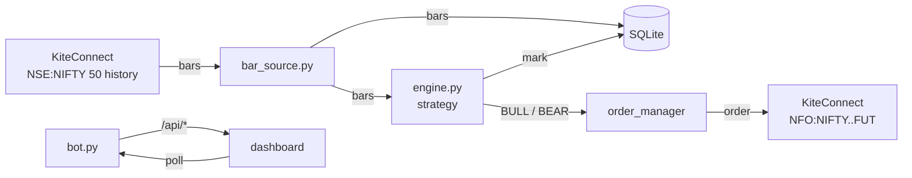

# Belaku

Algorithmic execution for **NIFTY 50 → Nifty Futures**.

Belaku watches NIFTY 50, evaluates a SuperTrend (14×3) + Parabolic SAR strategy
on completed candles, and trades the NFO Nifty future (front month, rolled five
days before expiry). No TradingView
in the loop — the indicators are computed locally and verified against the Pine
reference.



## The one idea that explains the design

**The signal source is not the execution venue.**

NIFTY 50 is the index the Nifty future tracks, but it is an index, not a
tradeable contract. So Belaku reads signals from NIFTY 50 and places orders on
the NFO Nifty future.

Everything else follows from that split: a warm-up that runs on closed bars, and
a LIVE path that defers signals arriving outside the NSE session rather than
firing them late.

## What it does, precisely

| | |
|---|---|
| **Signal source** | `NSE:NIFTY 50`, 60-minute bars from Kite history |
| **Execution venue** | Front-month `NFO` Nifty future |
| **Entry rule** | SuperTrend (14×3) agrees **and** price on the correct side of PSAR |
| **Warm-up** | 15 closed bars (SuperTrend ATR length + 1) |
| **Signal trigger** | First closed bar where the condition becomes true — not repeated while it holds |
| **Exit** | The pair flips against the position, or manual. **No stop-loss and no profit target.** |
| **Modes** | `PAPER` (simulated) and `LIVE` (real orders, explicit confirmation) |

:::note[The signal is the exit]
There is no stop-loss, no trailing stop, and no profit target. A position is held
until SuperTrend and PSAR flip the *other* way and then closed in full — that is
the whole exit rule. A bar where the pair merely disagrees is held, not cut. The
only exposure limit is `MAX_OPEN_LOTS`; there is no session loss cap, because
blocking entries on the day's realised loss is a second strategy the signal never
looked at.

:::warning[Read the backtest before trading this]
On three years of real NIFTY 60-minute bars the strategy's gross profit
factor is **0.98** — it wins roughly nothing in the market and gives the rest to
the broker as charges, netting **−₹513,294 over 463 trades**. The one filtered
configuration that clears costs fails walk-forward and is beaten by buy-and-hold.
See [Backtesting](./backtesting.md) for the full result before trusting any
signal this bot produces.
:::
:::

## Requirements

- Python **3.12+** (the Docker image uses 3.12)
- A Zerodha Kite Connect account with API credentials
- A valid access token — **required even in PAPER mode**, because PAPER mocks
  orders, not market data

## Quick start

```bash
python3.12 -m venv .venv && .venv/bin/pip install -r requirements-dev.txt
cp bot/.env.example bot/.env          # then add KITE_API_KEY / KITE_API_SECRET
.venv/bin/python bot/bot.py
```

Dashboard: [http://127.0.0.1:9000](http://127.0.0.1:9000)

Or with Docker:

```bash
docker compose up -d --build
```

See [Setup](/setup) for credentials and [Running](/running) for Docker details.

## Honest limitations

These are real and worth knowing before you run it with money:

- **Stops are off by default.** A position is closed by an opposite signal, by
  hand, or by a stop you have explicitly enabled. Turning one on is a decision,
  not a default.
- **Single writer.** SQLite allows one writer; this is a single-instance bot.
- **No holiday-aware LIVE deferral.** The NSE F&O calendar gates *orders*, not
  signal evaluation.
- **`bot/.env` is tracked in git.** It should not be — see
  [Setup](/setup#credentials).
