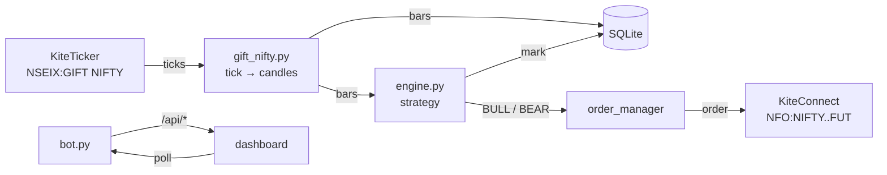

# Belaku

Algorithmic execution for **GIFT Nifty → Nifty Futures**.

Belaku watches GIFT Nifty, evaluates a SuperTrend (14×3) + Parabolic SAR strategy
on completed candles, and trades the NFO Nifty future (front month, rolled five
days before expiry). No TradingView
in the loop — the indicators are computed locally and verified against the Pine
reference.



## The one idea that explains the design

**The signal source is not the execution venue.**

GIFT Nifty trades ~20 hours a day on NSEIX and is the standard pre-market proxy
for Nifty 50 — it reacts to overnight global moves hours before NSE opens. But it
is an index, not a tradeable contract. So Belaku reads signals from GIFT Nifty and
places orders on the NFO Nifty future.

Everything else follows from that split: two market clocks, a warm-up that runs
around the clock, and a LIVE path that defers signals arriving outside the NSE
session rather than firing them late.

## What it does, precisely

| | |
|---|---|
| **Signal source** | `NSEIX:GIFT NIFTY`, 15-minute bars from Kite history |
| **Execution venue** | Front-month `NFO` Nifty future |
| **Entry rule** | SuperTrend (14×3) agrees **and** price on the correct side of PSAR |
| **Warm-up** | 15 closed bars (SuperTrend ATR length + 1) |
| **Signal trigger** | First closed bar where the condition becomes true — not repeated while it holds |
| **Exit** | The pair flips against the position, a protective stop, or manual. No profit target. |
| **Modes** | `PAPER` (simulated) and `LIVE` (real orders, explicit confirmation) |

:::note[The signal is the primary exit]
A position is held until SuperTrend and PSAR flip the *other* way and then closed
in full; a bar where the pair merely disagrees is held, not cut. Each book also
carries a **protective stop-loss and trailing stop** measured on the futures
execution price (see [Strategy](./strategy.md)), which caps a single loss without
changing when a winning trend is closed. There is no profit target.

Exposure is bounded by `MAX_OPEN_LOTS` and, optionally, `MAX_DAILY_LOSS` — a
daily realised-loss cap that blocks *new entries* once it is reached and never
flattens an open position.

:::warning[Read the backtest before trading this]
On three years of real GIFT Nifty 60-minute bars the strategy's gross profit
factor is **0.98** — it wins roughly nothing in the market and gives the rest to
the broker as charges, netting **−₹513,294 over 463 trades**. The one filtered
configuration that clears costs fails walk-forward and is beaten by buy-and-hold.
See [Backtesting](./backtesting.md) for the full result before trusting any
signal this bot produces.
:::
:::

## Requirements

- Python **3.12+** (the Docker image uses 3.12)
- A Zerodha Kite Connect account with API credentials
- A valid access token — **required even in PAPER mode**, because PAPER mocks
  orders, not market data

## Quick start

```bash
python3.12 -m venv .venv && .venv/bin/pip install -r requirements-dev.txt
cp bot/.env.example bot/.env          # then add KITE_API_KEY / KITE_API_SECRET
.venv/bin/python bot/bot.py
```

Dashboard: [http://127.0.0.1:9000](http://127.0.0.1:9000)

Or with Docker:

```bash
docker compose up -d --build
```

See [Setup](/setup) for credentials and [Running](/running) for Docker details.

## Honest limitations

These are real and worth knowing before you run it with money:

- **Stops are off by default.** A position is closed by an opposite signal, by
  hand, or by a stop you have explicitly enabled. Turning one on is a decision,
  not a default.
- **Single writer.** SQLite allows one writer; this is a single-instance bot.
- **No holiday-aware LIVE deferral for GIFT.** GIFT Nifty trades on NSEIX
  holidays; the NSE F&O calendar gates *orders*, not signal evaluation. The
  signal series is gated to the 09:15–15:30 session, so an NSEIX holiday simply
  produces no bars to evaluate.
- **`bot/.env` is tracked in git.** It should not be — see
  [Setup](/setup#credentials).
