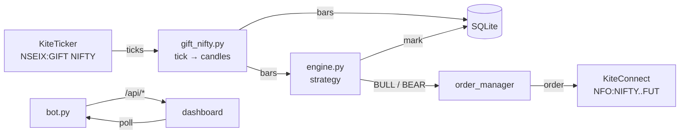

# Belaku

Algorithmic execution for **GIFT Nifty → Nifty Futures**.

Belaku watches GIFT Nifty, evaluates a triple-SuperTrend + Parabolic SAR strategy
on completed candles, and trades the front-month NFO Nifty future. No TradingView
in the loop — the indicators are computed locally and verified against the Pine
reference.



## The one idea that explains the design

**The signal source is not the execution venue.**

GIFT Nifty trades ~20 hours a day on NSEIX and is the standard pre-market proxy
for Nifty 50 — it reacts to overnight global moves hours before NSE opens. But it
is an index, not a tradeable contract. So Belaku reads signals from GIFT Nifty and
places orders on the NFO Nifty future.

Everything else follows from that split: two market clocks, a warm-up that runs
around the clock, and a LIVE path that defers signals arriving outside the NSE
session rather than firing them late.

## What it does, precisely

| | |
|---|---|
| **Signal source** | `NSEIX:GIFT NIFTY`, 5-minute bars from Kite history |
| **Execution venue** | Front-month `NFO` Nifty future |
| **Entry rule** | 2-of-3 SuperTrend agree **and** price on the correct side of PSAR |
| **Warm-up** | 14 closed bars (longest SuperTrend ATR + 1) |
| **Signal trigger** | First closed bar where the condition becomes true — not repeated while it holds |
| **Exit** | Opposite signal, or manual. **There is no stop-loss or profit target.** |
| **Modes** | `PAPER` (simulated) and `LIVE` (real orders, explicit confirmation) |

:::danger[No stop-loss]
The strategy has no stop-loss and no profit target. Exits are an opposite signal
or a manual square-off. Size positions accordingly — this is a deliberate
property of the strategy, not a missing feature.
:::

## Requirements

- Python **3.12+** (the Docker image uses 3.12)
- A Zerodha Kite Connect account with API credentials
- A valid access token — **required even in PAPER mode**, because PAPER mocks
  orders, not market data

## Quick start

```bash
python3.12 -m venv .venv && .venv/bin/pip install -r requirements.txt
cp bot/.env.example bot/.env          # then add KITE_API_KEY / KITE_API_SECRET
.venv/bin/python bot/bot.py
```

Dashboard: [http://127.0.0.1:9000](http://127.0.0.1:9000)

Or with Docker:

```bash
docker compose up -d --build
```

See [Setup](/setup) for credentials and [Running](/running) for Docker details.

## Honest limitations

These are real and worth knowing before you run it with money:

- **No stop-loss.** A position is only closed by an opposite signal or by hand.
- **Single writer.** SQLite allows one writer; this is a single-instance bot.
- **No holiday-aware LIVE deferral for GIFT.** GIFT Nifty trades on NSEIX
  holidays; the NSE F&O calendar gates *orders*, not signal evaluation.
- **`bot/.env` is tracked in git.** It should not be — see
  [Setup](/setup#credentials).
