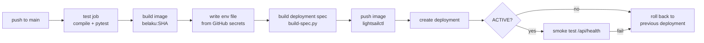

# Deploying to Lightsail container services

This page covers the GitHub Actions pipeline in
`.github/workflows/deploy-lightsail.yml`, which builds the image, pushes it to an
Amazon Lightsail container service, and deploys it.

:::danger Read this first: there is no persistent disk

A Lightsail container service has **no volumes**. Every deployment starts from
the image's own filesystem, so `/data` — and with it `paper_trading.db`,
`gift_book.db`, `paper_mirror.db`, the log file, and the Kite token the bot
writes back into `.env` — is **recreated empty on every deploy**.

A *restart* is different from a *deploy*: the container filesystem survives a
restart, so a token written by a dashboard login is still there afterwards. It
is a redeploy that wipes it.

That makes this target suitable for a **PAPER** deployment you are happy to
reset, not for a live trading record. If you need the ledger to survive a
redeploy, run the bot on a VM with a Docker volume instead — see
[Hosting](./hosting.md) — or add an off-box snapshot/restore step around this
pipeline before you arm LIVE.

:::

## What the pipeline does



| Step | Where |
| --- | --- |
| Test, compile | `test` job, `ubuntu-latest` |
| Build, push, deploy | `deploy` job, `ubuntu-latest` |
| Deployment spec | [`deploy/lightsail/build-spec.py`](https://github.com/surikbs-xp/belaku/blob/main/deploy/lightsail/build-spec.py) |
| Push, deploy, rollback | [`deploy/lightsail/deploy.py`](https://github.com/surikbs-xp/belaku/blob/main/deploy/lightsail/deploy.py) |

The deploy job only runs if the tests pass, and it is serialised by a
`concurrency` group so two pushes cannot race for the same service.

## One-time setup

### 1. Create the container service

The pipeline creates the service on first run, but creating it yourself lets you
pick the region and capacity deliberately:

```bash
aws lightsail create-container-service \
  --service-name belaku \
  --power micro \
  --scale 1 \
  --region ap-south-1
```

`micro` is 1 GB RAM / 0.25 shared vCPU at $10/month, which is the floor this bot
needs — pandas dominates startup. `scale 1` is correct: the bot is a single
process with one SQLite writer, and a second node would be a second bot trading
the same account.

:::warning[Capacity is not managed by the pipeline]

`create-container-service` sets power and scale once. The pipeline passes
`--power micro --scale 1` but only uses them when the service does not exist, so
a deploy never silently resizes (and reprices) a service you tuned by hand. Use
`aws lightsail update-container-service` for that.

:::

### 2. Credentials

The workflow supports two ways to authenticate. Prefer the first.

**GitHub OIDC (no long-lived keys).** Create an IAM role that trusts this
repository and can call the Lightsail container actions, then store its ARN:

```bash
gh secret set AWS_ROLE_ARN --body 'arn:aws:iam::123456789012:role/belaku-deploy'
```

The role needs `lightsail:GetContainerServices`,
`lightsail:CreateContainerService`,
`lightsail:CreateContainerServiceDeployment`,
`lightsail:CreateContainerServiceRegistryLogin`,
`lightsail:RegisterContainerImage`, and `lightsail:GetContainerLog`. It also
needs `iam:PassRole` only if you attach a private-registry role — this pipeline
does not.

```json title="belaku-deploy-permissions.json"
{
  "Version": "2012-10-17",
  "Statement": [
    {
      "Effect": "Allow",
      "Action": [
        "lightsail:GetContainerServices",
        "lightsail:CreateContainerService",
        "lightsail:CreateContainerServiceDeployment",
        "lightsail:CreateContainerServiceRegistryLogin",
        "lightsail:RegisterContainerImage",
        "lightsail:GetContainerLog"
      ],
      "Resource": "*"
    }
  ]
}
```

`Resource: "*"` is unavoidable here: `CreateContainerService` runs before the
service exists, so there is no ARN to scope to yet. The trust policy is what
actually limits the blast radius — pin it to this repository and to the
`lightsail` environment, so a workflow on any other branch cannot assume it:

```json title="belaku-deploy-trust.json"
{
  "Version": "2012-10-17",
  "Statement": [
    {
      "Effect": "Allow",
      "Principal": {
        "Federated": "arn:aws:iam::123456789012:oidc-provider/token.actions.githubusercontent.com"
      },
      "Action": "sts:AssumeRoleWithWebIdentity",
      "Condition": {
        "StringEquals": {
          "token.actions.githubusercontent.com:aud": "sts.amazonaws.com",
          "token.actions.githubusercontent.com:sub": "repo:surikbs-xp/belaku:environment:lightsail"
        }
      }
    }
  ]
}
```

The `:environment:lightsail` suffix is why step 4 matters: the deploy job
declares `environment: lightsail`, and a trust policy written for
`:ref:refs/heads/main` instead will not match.

:::note[There is no `lightsail:PushContainerImage`]

`aws lightsail push-container-image` is a CLI customization, not a modelled API
call: it shells out to the `lightsailctl` plugin, which authenticates to the
service's registry with `CreateContainerServiceRegistryLogin` and then records
the uploaded digest with `RegisterContainerImage`. Granting those two is what
makes the push work. A policy that names `PushContainerImage` grants nothing.

:::

**Access keys (fallback).** If the account has no GitHub OIDC provider, leave
`AWS_ROLE_ARN` unset and set the key pair instead:

```bash
gh secret set AWS_ACCESS_KEY_ID
gh secret set AWS_SECRET_ACCESS_KEY
```

### 3. Runtime secrets

The bot reads its configuration from the environment, so every value that
`bot/.env` would hold on a VM becomes a repository secret:

| Secret | Required | Notes |
| --- | --- | --- |
| `DASHBOARD_PASSWORD` | **yes** | The pipeline refuses to deploy without it |
| `KITE_API_KEY` | yes | Without it the bot starts but cannot trade |
| `KITE_API_SECRET` | yes | |
| `KITE_ACCESS_TOKEN` | no | Expires ~06:00 IST daily; see [the daily token](#the-daily-kite-token) |
| `KITE_USER_ID` | no | Headless login; see the caveat below |
| `KITE_PASSWORD` | no | Headless login |
| `KITE_TOTP_SECRET` | no | Headless login; the 2FA secret, not a code |
| `DASHBOARD_SESSION_SECRET` | recommended | Keeps dashboard logins across a redeploy |
| `ALERT_ENABLED` | optional | `1` sends alerts; leave unset/`0` to keep the bot silent |
| `ALERT_CHANNEL` | recommended | `telegram` or `webhook` |
| `ALERT_WEBHOOK_URL` | if `webhook` | |
| `ALERT_TELEGRAM_BOT_TOKEN` | if `telegram` | |
| `ALERT_TELEGRAM_CHAT_ID` | if `telegram` | |

```bash
gh secret set DASHBOARD_PASSWORD --body "$(python3 -c 'import secrets; print(secrets.token_urlsafe(24))')"
gh secret set KITE_API_KEY
gh secret set KITE_API_SECRET
```

Unset secrets are skipped rather than written as empty strings, so a missing
`ALERT_CHANNEL` leaves the bot's own default in place instead of blanking it.

### 4. The `lightsail` environment

The deploy job targets a GitHub environment named `lightsail`. Create it and add
required reviewers if you want a human gate before a deploy reaches the service:

```bash
gh api -X PUT repos/surikbs-xp/belaku/environments/lightsail
```

This is not optional when you use OIDC: the trust policy in step 2 matches on
`repo:surikbs-xp/belaku:environment:lightsail`, and a job that declares no
environment presents a `:ref:refs/heads/main` subject instead, which the policy
rejects. With access keys the environment is only a gate, not a requirement.

### Skipping the deploy

The `preflight` job decides whether the deploy can run. With **no** AWS secret
set, `deploy` is skipped and the workflow stays green; the bot also runs from
`docker compose up` and from [`deploy/belaku.service`](hosting.md), so an
un-deployed repository is a valid state and a red run should mean the code broke.

Two cases still fail, deliberately:

| Situation | Result |
| --- | --- |
| Only one of `AWS_ACCESS_KEY_ID` / `AWS_SECRET_ACCESS_KEY` set | `preflight` fails — a half-configured key pair is a mistake, not an absent integration |
| `workflow_dispatch` | `deploy` always runs, so a manual deploy is never silently skipped |

### 5. Register the callback URL with Kite

The bot's public domain is assigned by Lightsail and is not known until the
service exists, so this step comes *after* the first deploy. Read the URL:

```bash
aws lightsail get-container-services --service-name belaku --region ap-south-1 \
  --query 'containerServices[0].url' --output text
```

Then add `https://<that-domain>/zerodha/callback` as a **Redirect URL** in the
[Kite developer console](https://developers.kite.trade/) for your app. The
pipeline sets `KITE_REDIRECT_URL` to exactly this value on every deploy, so a
mismatch here is what makes the daily login fail with `Invalid redirect url`.

## How the deployment spec is built

Lightsail never reads `compose.yaml`, so the settings that file pins have to be
repeated in the deployment spec. `build-spec.py` supplies them as defaults:

| Variable | Value | Why |
| --- | --- | --- |
| `WEBHOOK_HOST` | `0.0.0.0` | The platform forwards to the container, not to loopback |
| `WEBHOOK_PORT` | `9000` | Matches the public endpoint |
| `DB_PATH` | `/data/paper_trading.db` | |
| `GIFT_BOOK_DB_PATH` | `/data/gift_book.db` | |
| `PAPER_MIRROR_DB_PATH` | `/data/paper_mirror.db` | |
| `LOG_FILE` | `/data/bot.log` | |
| `HOLIDAY_CACHE_PATH` | `/data/nse_holidays.json` | |
| `EXECUTION_MODE` | `PAPER` | A pipeline that deploys on every push must not arm LIVE |

Two more values can only be known once the service exists, so `deploy.py` adds
them after the first `get-container-services` call:

- **`ALLOWED_HOSTS`** — the service's public domain. Without it
  `TrustedHostMiddleware` rejects every request, including the browser's.
- **`KITE_REDIRECT_URL`** — `https://<public-domain>/zerodha/callback`.
  Register this exact URL in the Kite developer console, or the daily token
  refresh cannot complete.

Both use `setdefault`, so a value you pin in the environment file wins.

### The health check accepts 4xx on purpose

The public endpoint's health check is `GET /api/health` with
`successCodes: 200-499`. The platform's probe does not necessarily send the
service's public `Host` header, and `TrustedHostMiddleware` answers **400** to a
request whose `Host` is not allowed — while the process is perfectly healthy. A
5xx still fails the check, which is what it is for: is the app serving?

## Deploying

Automatic on every push to `main` that touches anything outside `website/` and
`*.md`. Manual, with an explicit mode:

```bash
gh workflow run deploy-lightsail.yml -f execution_mode=PAPER
```

The `execution_mode` input only applies to `workflow_dispatch`; a push deploy
always uses `PAPER` unless you set `EXECUTION_MODE` in the environment file.

### What happens on failure

If the deployment does not reach `ACTIVE`, or the smoke test never sees
`{"ok": true}` from `/api/health`, the script re-submits the **previous**
deployment's containers and endpoint. The service is left running the last
known-good image rather than nothing. Pass `--no-rollback` to skip that.

The workflow also dumps the last 200 container log lines on failure.

## Operating it

```bash
# Current state and public URL
aws lightsail get-container-services --service-name belaku --region ap-south-1 \
  --query 'containerServices[0].{state:state,url:url,deployment:currentDeployment.state}'

# Logs (stdout/stderr of the container)
aws lightsail get-container-log --service-name belaku \
  --container-name bot --region ap-south-1 --output text | tail -n 100

# Roll back by hand to a previous deployment version
aws lightsail get-container-service-deployments --service-name belaku --region ap-south-1
aws lightsail create-container-service-deployment --service-name belaku \
  --cli-input-json file://previous.json --region ap-south-1
```

Lightsail keeps the last 50 deployment versions, so a bad release is recoverable
without rebuilding.

## The daily Kite token

Kite has no token API and no refresh token: the access token comes from a
browser redirect and dies around 06:00 IST. That is the single hardest
constraint on running this bot unattended, and it is worth being blunt about
what does and does not work.

### Headless login, and why it does not work from a cloud host

`bot/kite_autologin.py` implements the full browser flow in code — password,
TOTP, the connect-login redirect, the token exchange — so the bot can mint a
token on startup and again whenever the token is rejected. Set these three
secrets and it runs with no human:

| Secret | Value |
| --- | --- |
| `KITE_USER_ID` | Your Zerodha client id, e.g. `AB1234` |
| `KITE_PASSWORD` | The account password |
| `KITE_TOTP_SECRET` | The TOTP secret from 2FA setup (not a current code) |

**But Zerodha gates `/api/login` behind a CAPTCHA for traffic it treats as
automated**, and a datacenter IP — a GitHub runner, a Lightsail container — is
exactly that. The endpoint answers:

```json
{"status":"error","message":"Invalid CAPTCHA values.","data":{"captcha":true}}
```

This was verified against the live endpoint while building this pipeline. It is
not a bug in the implementation and there is no parameter that bypasses it:
solving the CAPTCHA is the point of the challenge. The bot detects this case
specifically (`CaptchaRequired`), logs it once, and does **not** retry — retrying
a CAPTCHA challenge looks like credential stuffing and risks the account.

So on Lightsail, headless login works only if the egress IP is one Zerodha does
not flag. In practice that means it does not work, and the token has to come
from somewhere else.

### What actually works

| Approach | Manual steps | Notes |
| --- | --- | --- |
| Log in through the dashboard | One per trading day | No redeploy; survives a restart, not a redeploy |
| Refresh `KITE_ACCESS_TOKEN` secret + redeploy | One per trading day | `scripts/kite-token.py --github`, then `gh workflow run` |
| Run on a residential/VPS IP and use headless login | None | Only if Zerodha does not challenge that IP |
| Run on a VM with a persistent volume | One per trading day, via the dashboard | The token survives restarts *and* redeploys — see [Hosting](./hosting.md) |

### Refreshing the token with the helper script

`scripts/kite-token.py` runs the three steps that are easy to get wrong by hand:
it builds the login URL from the app's own `api_key`, exchanges the
`request_token` for an access token, **verifies the token with Kite before
claiming success**, writes it into `bot/.env`, and can push it to the
`KITE_ACCESS_TOKEN` secret.

```bash
# Interactive: prints the login URL, paste the redirect URL back.
scripts/kite-token.py

# Publish the token you already have (re-checks it is still valid first).
scripts/kite-token.py --push-secret

# Both at once, for the daily Lightsail routine.
scripts/kite-token.py --request-token '<redirect URL>' --github
```

A `request_token` is single-use and expires within a minute, so paste the
redirect promptly; if it is rejected, run the script again for a fresh URL. No
dependency install is needed — the exchange is done with `urllib` and
`hashlib`.

### Logging in through the dashboard

This is the intended path on Lightsail, and it needs no redeploy:

1. Open `https://<public-domain>/` and sign in with `DASHBOARD_PASSWORD`.
2. Click **Connect**, complete the Zerodha login and 2FA.
3. Zerodha redirects to `/zerodha/callback`; the bot exchanges the
   `request_token`, applies it to the running client immediately, and writes it
   into `bot/.env` inside the container.

The token is live as soon as the callback returns — the process does not need to
restart. It also **survives a restart**: `config.py` re-reads `KITE_ACCESS_TOKEN`
from `.env` after `load_dotenv`, so the freshly written token beats the stale one
in the deployment spec. Only that one key is re-read; the rest of `.env` cannot
override the deployment's settings.

What it does not survive is a **redeploy**. Lightsail recreates the container
filesystem from the image, so `.env` is gone and the spec's `KITE_ACCESS_TOKEN`
takes over again. If you redeploy after logging in, either log in again or copy
the token into the `KITE_ACCESS_TOKEN` secret first.

:::warning[Do not automate around the CAPTCHA]

Solving or outsourcing the CAPTCHA, or rotating IPs to dodge the challenge,
violates Zerodha's terms and puts the trading account at risk. If the account
must run unattended, the supported answer is a host Zerodha does not challenge,
not a workaround.

:::

## Security notes

- **The dashboard is on the public internet.** `DASHBOARD_PASSWORD` is
  mandatory in the pipeline for that reason; the build fails without it. Set
  `ALLOW_OPEN_DASHBOARD=1` in the environment file only if you truly mean to
  expose an unauthenticated control API.
- **Secrets are written to a file, never to the build.** They are not
  `--build-arg`s and not image layers, so they do not appear in the build log or
  in a pushed image.
- **`ENABLE_API_DOCS` stays off.** The schema enumerates every control endpoint,
  including the one that squares off live positions.
- **The image runs as uid 10001** with no capabilities, exactly as it does under
  compose. Lightsail does not let you add `cap_drop` or `read_only`, so those
  compose-level hardening options are not applied here — the non-root user is
  the part that carries over.

## When not to use this

| Situation | Use instead |
| --- | --- |
| You need the trading record to survive a deploy | A VM with a Docker volume — [Hosting](./hosting.md) |
| You want the dashboard unreachable from the internet | A VM plus an SSH tunnel or Tailscale |
| You are running LIVE | A VM, until the ledger has off-box persistence |
| You need the daily Kite token refreshed with no human | A host Zerodha does not CAPTCHA — see [the daily token](#the-daily-kite-token) |

The pipeline is a good fit for a PAPER instance you want rebuilt on every merge,
and a poor fit for the box that holds your trade history.
