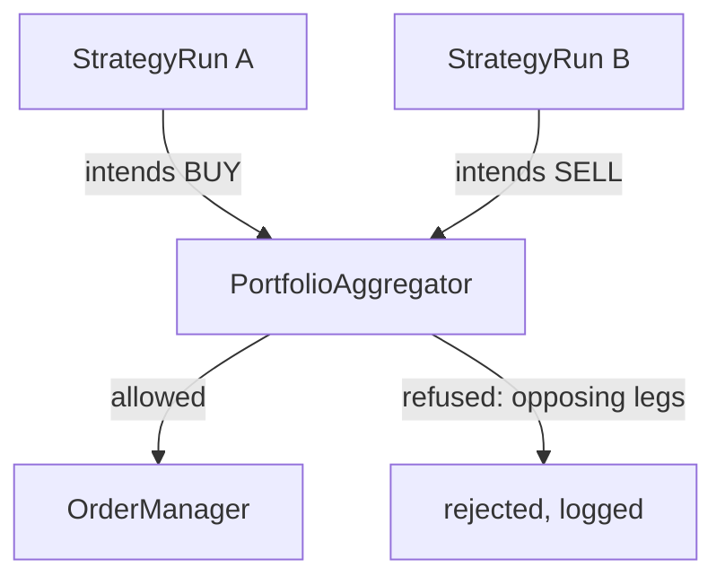

# Running multiple strategies

The bot can trade more than one strategy at once, each with its own signals,
positions and P&L. This page explains how to configure that and — more
importantly — the one way two strategies can silently ruin each other.

## Quick start

With nothing configured, the bot runs **one** strategy built from the flat keys
(`STRATEGY_EXIT`, `GIFT_CANDLE_INTERVAL`, …). That is the single-book behaviour
the bot has always had, and an unchanged `.env` behaves identically.

Adding a second book is configuration only:

```bash
STRATEGY_2_SOURCE=nifty
STRATEGY_2_ID=nifty-adx
STRATEGY_2_NAME=nifty adx
STRATEGY_2_INTERVAL=60minute
STRATEGY_2_EXIT=flip
STRATEGY_2_LOTS=1
```

The first strategy can also be written out explicitly, which is what to do when
you want both declared in one place:

```bash
STRATEGY_1_SOURCE=gift
STRATEGY_1_ID=gift-flip
STRATEGY_1_INTERVAL=60minute
STRATEGY_1_EXIT=flip
```

| Key | Meaning |
|---|---|
| `STRATEGY_<n>_SOURCE` | `gift` or `nifty`. **Required** for anything above 1. |
| `STRATEGY_<n>_ID` | The ledger book. Must be unique — see below. |
| `STRATEGY_<n>_NAME` | Display name only. |
| `STRATEGY_<n>_INTERVAL` | Kite bar interval. |
| `STRATEGY_<n>_EXIT` | `flip` (default) or `flat`. |
| `STRATEGY_<n>_LOTS` | Position size for this run. |
| `STRATEGY_<n>_ENABLED` | `0` leaves it configured but not started. |
| `STRATEGY_<n>_LIVE` | `1` places real orders when `EXECUTION_MODE=LIVE`. Default `0`. |
| `STRATEGY_<n>_FILTER_ADX` | Optional entry gate on trend strength. |
| `STRATEGY_<n>_FILTER_MA` | Optional entry gate on the trend's side of an SMA. |

## Mixed paper and live books

`EXECUTION_MODE` is the master switch — in `PAPER` nothing is live, so a book
with `LIVE=1` still simulates. Switched to `LIVE`, each book trades real money
**only if it opted in**:

| Book | `STRATEGY_<n>_LIVE` | Bot `PAPER` | Bot `LIVE` |
|---|---|---|---|
| A | `0` | paper | **paper** |
| B | `1` | paper | **live** |

That is the recommended configuration for this pair, and the reason the switch
is per book rather than global:

- **GIFT Nifty cannot be traded as itself.** It is an index on Kite, so a LIVE
  order from the GIFT book is filled as a Nifty *future* — a different
  instrument from the series that produced the signal, with the index/future
  basis moving the entry. `STRATEGY_1_LIVE=0` keeps it in paper permanently.
- **The NIFTY book reads the series it is executed against**, so its signals and
  its fills describe the same instrument. `STRATEGY_2_LIVE=1` lets it trade.

A book left at `0` is not merely "not traded": its orders, fills, positions,
equity and P&L all stay in the **paper** ledger while the other book's go to the
live one. The two ledgers are separate rows (`positions.mode`), so nothing is
shared or blended. The dashboard labels each band with the mode that book is
actually running, and that label is read from the ledger the figures beside it
came from — a live-looking label on a paper balance is the number a trader would
misread.

Defaulting to `0` is deliberate. An unset flag must never be what puts real money
on a signal nobody considered funding, so arming is always an explicit act per
book.

The filters gate entries only — an open position is still closed by the exit
rule. A filtered bar reports `NO_SIGNAL` with the reason in `filter_reason`, so
the dashboard shows which gate refused instead of a bare missing signal.

The GIFT Nifty index book is settled **only** by a strategy whose source is GIFT.
It is priced on the GIFT level, so a NIFTY-signalled run must not drive it; with
no GIFT strategy configured, `GIFT_BOOK` has nothing to settle and should be `0`.

A numbered strategy with no `SOURCE` is **skipped**, not defaulted. Otherwise a
typo would silently duplicate the first book — two runs trading the same series,
doubling every order and fighting over the same positions.

An unknown `SOURCE` raises at build time and the run is skipped with an error in
the log, rather than trading a series nobody chose.

## The thing that makes this dangerous

Two strategies trade the **same front-month NIFTY future**. There is only one.
Zerodha reports **one netted position per contract**, which means:

```
Strategy A: LONG  1 lot   ->  ledger +65
Strategy B: SHORT 1 lot   ->  ledger -65
broker sees               ->      0
```

That is not two positions. It is one flat position. Three consequences follow,
and only the third is obvious:

1. **Margin and P&L are not what the books claim.** Summing the two books' P&L is
   not the broker's P&L on that contract.
2. **A reversal in one book cancels the other.** B's short closes A's long.
3. **The broker reconciliation stops detecting drift.** It compares ledger net to
   broker net; with opposing books those agree by construction.

The bot therefore enforces a portfolio rule: **two strategies may never hold
opposing legs in the same contract.** An intended long is refused while another
book holds a short, and the refusal names the book.



Other rules in the same place:

- **`MAX_OPEN_LOTS` is a portfolio budget.** Two runs at the per-run limit would
  otherwise double the configured exposure.
- **Exits are never blocked.** A trapped position is worse than an over-sized
  one, and refusing a square-off would trap every book at once.
- **`PANIC` is deliberately unscoped.** The operator's square-off closes every
  book, not one.

## Ledger attribution

Every row — position, order, trade, signal — carries a `strategy_id`. That is what
separates the books, because the symbol cannot: both are `NIFTY26NOVFUT`.

- `get_open_positions(strategy_id=…)` is used by everything that decides something
  for one book. Omitting it returns the whole portfolio, which is only correct for
  `PANIC`, the mark loop and the broker reconciliation.
- A trade inherits `strategy_id` from the position it closes, so it cannot be
  attributed to a book that did not open it.
- An upgraded ledger is backfilled to `Surikbs` rather than left `NULL`, so a
  scoped query keeps returning the old history instead of making it vanish.

:::warning[Setting `STRATEGY_ID` wrong looks like a flat book]
If a run's id does not match the rows in the database, the bot will report no
positions and open new ones beside them. Only change it deliberately, and never
while a position is open.
:::

## The owed-entry latch

A signal that closes out of session is remembered and honoured on the next bar
that can fill it. Each run has its own latch, keyed `engine_pending_signal:<id>`.

This matters more than it looks: the key used to be global. Two books sharing it
would overwrite each other's deferred entry on every bar — one strategy silently
adopting a signal it never saw, and trading it.

A ledger written before this change holds the bare key `engine_pending_signal`.
Only the original book (`Surikbs`) may adopt it; a new strategy starts flat.

## Reporting

`GET /api/strategies` returns each configured strategy, each running book's state,
and the portfolio exposure:

```json
{
  "configured": [{"id": "Surikbs", "source": "gift", "...": "..."},
                 {"id": "nifty-adx", "source": "nifty", "...": "..."}],
  "runs": [{"id": "Surikbs", "state": {"last_signal": "BEAR", "...": "..."}},
           {"id": "nifty-adx", "state": {"last_signal": "BULL", "...": "..."}}],
  "portfolio": {
    "strategies": [{"strategy_id": "Surikbs", "net_units": 65},
                   {"strategy_id": "nifty-adx", "net_units": -65}],
    "netted": {"NIFTY26NOVFUT": 0},
    "conflicts": ["NIFTY26NOVFUT"]
  }
}
```

Both the per-strategy rows and `netted` are returned because they answer
different questions. The first says what each book believes it holds; the second
is what the broker will report. A divergence — or a `conflicts` entry — is the
fact an operator needs to see.

## Operating notes

- **Start both in PAPER.** The NIFTY strategy has 87 trades of evidence and a
  confidence interval that includes zero. Parallel running is how you *earn* the
  evidence, not a reason to size up.
- **Two feeds cost two history calls.** Both at 60-minute bars, refreshed every
  30 s, is trivial against Kite's rate limit — but it is not zero.
- **One loop means one slow feed delays both.** `refresh_history` cannot raise
  and cannot empty the series; keep that property.
- **Sizing.** Two runs at 1 lot each with `MAX_OPEN_LOTS=4` leaves headroom. The
  no-opposing-legs rule, not the lot cap, is what keeps the pair sane.

## Implementation map

| Concern | Module |
|---|---|
| One strategy's state, source and params | [`bot/strategy_run.py`](https://github.com/surikbs-xp/belaku/blob/main/bot/strategy_run.py) |
| Where bars come from | [`bot/bar_source.py`](https://github.com/surikbs-xp/belaku/blob/main/bot/bar_source.py) |
| Cross-strategy exposure rules | [`bot/portfolio.py`](https://github.com/surikbs-xp/belaku/blob/main/bot/portfolio.py) |
| Strategy-scoped netting and square-off | [`bot/order_manager.py`](https://github.com/surikbs-xp/belaku/blob/main/bot/order_manager.py) |
| `STRATEGY_<n>_*` parsing | [`bot/config.py`](https://github.com/surikbs-xp/belaku/blob/main/bot/config.py) |
