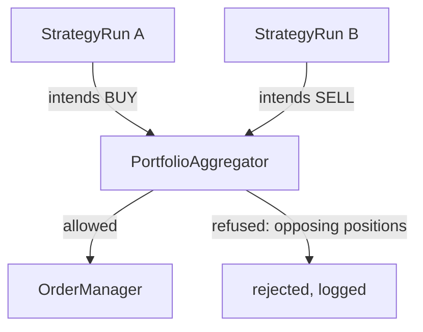

# The two strategies

The bot implements **exactly two** strategies. There is no third, and neither is
optional. They run independently and simultaneously, each with its own signals,
positions, orders, quantity and P&L — and each with its own LIVE/PAPER toggle,
pause switch, manual BUY/SELL and square-off.

| | GIFT NIFTY 15m | NIFTY 60m |
|---|---|---|
| Signal source | `NSEIX:GIFT NIFTY` | `NSE:NIFTY 50` |
| Timeframe | 15 minutes | 60 minutes |
| Execution | NFO NIFTY future | NFO NIFTY future |
| Exit rule | `flat` — closes on a confirmed `NO_SIGNAL` | `flip` — holds through `NO_SIGNAL` |
| Stop-loss | none | none |

Neither book carries a stop-loss or a trailing stop. The signal is the only exit,
so nothing is placed at the broker to close a position and there is no level to
measure. See [why there is no trail](#why-there-is-no-trail).

## These are the specification, not defaults

The source, timeframe, exit rule and display name come from the code, not from
the environment. A `.env` that set `STRATEGY_3_INTERVAL=60minute` silently moved
the 15-minute book onto 60-minute bars.

`STRATEGY_<n>_*` still tunes the operational knobs:

| Key | Meaning |
|---|---|
| `STRATEGY_<n>_ID` | The ledger book. Must be unique — see below. |
| `STRATEGY_<n>_LOTS` | Position size for this book. |
| `STRATEGY_<n>_ENABLED` | `0` leaves it configured but not started. |
| `STRATEGY_<n>_LIVE` | Initial LIVE/PAPER choice. Default `0`; the dashboard toggle persists the operator's choice. |
| `STRATEGY_<n>_FILTER_ADX` | Optional entry gate on trend strength. |
| `STRATEGY_<n>_FILTER_MA` | Optional entry gate on the trend's side of an SMA. |

`<n>` is `1` for the GIFT book and `2` for the NIFTY book. Anything numbered above
2 is ignored — there is no third strategy to configure.

:::warning[Numbering is a label, not a position]
A deployment that declared `STRATEGY_2_*` and `STRATEGY_3_*` and left
`STRATEGY_1_*` unset used to get **three** books: an implied first book from the
flat keys, plus the two declared ones. The operator had configured two strategies
and the dashboard showed three, with a GIFT book nobody asked for — and because
the implied book took its interval from `GIFT_CANDLE_INTERVAL`, it read the same
series as a real book at a different timeframe.

There are now always exactly two books, whatever the environment says.
:::

The engine logs the books it built at startup, so the resolved set is never a
guess:

```
Strategy books (2): gift-15m [GiftBarSource 15minute], nifty-60m [NiftyBarSource 60minute]
```

## Why there is no trail

Both books ship with **no stop-loss and no trailing stop**. The initial stop is
gone entirely; the exit rule is the only thing that closes a position.

A trail is a second exit rule competing with the signal, and it wins that
competition on most trades: it closes at a fixed distance from the best price, so
a trade that would have run to a full trend reversal is cut short. Measured on
three years of session-gated 60-minute GIFT bars, with 10 points of adverse
slippage on every stop fill:

| Trail | `nifty-60m` net | `gift-15m` net |
|---|---|---|
| **none** | **+₹379,340** | **+₹260,481** |
| 5 @ +200 | +₹320,095 | +₹258,329 |
| 20 @ +200 | +₹277,228 | +₹208,962 |
| 50 @ +200 | +₹245,215 | +₹180,167 |
| 100 @ +200 | +₹153,396 | +₹106,782 |

Every trail distance tested reduced net on both books. The trail converts the
large winners that pay for the stop-outs into small ones.

The cost is real and deliberate: a trade can run to a large open profit and give
all of it back, and a single loss is not capped. That is the trade being made — a
lower win rate (28–36%) for a higher profit factor (1.4–1.5), and it is the only
configuration tested that was positive in every calendar year.

## Independent LIVE / PAPER

Each book has its own LIVE/PAPER switch, independent of the other and of the
process-wide `EXECUTION_MODE`. The dashboard toggle persists the choice across
restarts.

- **PAPER → LIVE** requires confirmation and the same pre-flight the global
  switch enforces. It never executes an existing paper position: the live book
  starts flat and waits for its own fresh signal.
- **LIVE → PAPER** is refused while the live book still holds a position. Square
  it off (or reconcile it) first, or the operator would be left with a real
  position the bot no longer manages.

A book left in paper is not merely "not traded": its orders, fills, positions,
equity and P&L all stay in the **paper** ledger while the other book's go to the
live one. The two ledgers are separate rows (`positions.mode`), so nothing is
shared or blended. The dashboard labels each band with the mode that book is
actually running, and that label is read from the ledger the figures beside it
came from — a live-looking label on a paper balance is the number a trader would
misread.

Defaulting to paper is deliberate. An unset flag must never be what puts real
money on a signal nobody considered funding, so arming is always an explicit act
per book.

## Independent pause and square off

Each book has its own **Pause**, **Resume** and **Square off** controls.

- **Pause** stops new entries for that book only. Existing positions are still
  closed by the signal. Pausing one book never pauses the other.
- **Resume** accepts the next valid signal. A signal that fired while paused is
  not replayed — the book waits for a fresh transition.
- **Square off** closes only that book's positions, verifies the fill in LIVE,
  and then pauses the book. It never touches the other book's leg in the same
  contract.

The filters gate entries only — an open position is still closed by the exit
rule. A filtered bar reports `NO_SIGNAL` with the reason in `filter_reason`, so
the dashboard shows which gate refused instead of a bare missing signal.

## The thing that makes this dangerous

Two strategies trade the **same front-month NIFTY future**. There is only one.
Zerodha reports **one netted position per contract**, which means:

```
Strategy A: LONG  1 lot   ->  ledger +65
Strategy B: SHORT 1 lot   ->  ledger -65
broker sees               ->      0
```

That is not two positions. It is one flat position. Three consequences follow,
and only the third is obvious:

1. **Margin and P&L are not what the books claim.** Summing the two books' P&L is
   not the broker's P&L on that contract.
2. **A reversal in one book cancels the other.** B's short closes A's long.
3. **The broker reconciliation stops detecting drift.** It compares ledger net to
   broker net; with opposing books those agree by construction.

The bot therefore enforces a portfolio rule: **two strategies may never hold
opposing positions in the same contract.** An intended long is refused while
another book holds a short, and the refusal names the book.



Other rules in the same place:

- **`MAX_OPEN_LOTS` is a portfolio budget.** Two runs at the per-run limit would
  otherwise double the configured exposure.
- **Exits are never blocked.** A trapped position is worse than an over-sized
  one, and refusing a square-off would trap every book at once.
- **`PANIC` is deliberately unscoped.** The operator's square-off closes every
  book, not one.

## Ledger attribution

Every row — position, order, trade, signal — carries a `strategy_id`. That is what
separates the books, because the symbol cannot: both are `NIFTY26NOVFUT`.

- `get_open_positions(strategy_id=…)` is used by everything that decides something
  for one book. Omitting it returns the whole portfolio, which is only correct for
  `PANIC`, the mark loop and the broker reconciliation.
- A trade inherits `strategy_id` from the position it closes, so it cannot be
  attributed to a book that did not open it.
- An upgraded ledger is backfilled to `Surikbs` rather than left `NULL`, so a
  scoped query keeps returning the old history instead of making it vanish.

:::warning[Setting `STRATEGY_ID` wrong looks like a flat book]
If a run's id does not match the rows in the database, the bot will report no
positions and open new ones beside them. Only change it deliberately, and never
while a position is open.
:::

## The owed-entry latch

A signal that closes out of session is remembered and honoured on the next bar
that can fill it. Each run has its own latch, keyed `engine_pending_signal:<id>`.

This matters more than it looks: the key used to be global. Two books sharing it
would overwrite each other's deferred entry on every bar — one strategy silently
adopting a signal it never saw, and trading it.

A ledger written before this change holds the bare key `engine_pending_signal`.
Only the original book (`Surikbs`) may adopt it; a new strategy starts flat.

## Reporting

`GET /api/strategies` returns each configured strategy, each running book's state,
and the portfolio exposure:

```json
{
  "configured": [{"id": "Surikbs", "source": "gift", "...": "..."},
                 {"id": "nifty-adx", "source": "nifty", "...": "..."}],
  "runs": [{"id": "Surikbs", "state": {"last_signal": "BEAR", "...": "..."}},
           {"id": "nifty-adx", "state": {"last_signal": "BULL", "...": "..."}}],
  "portfolio": {
    "strategies": [{"strategy_id": "Surikbs", "net_units": 65},
                   {"strategy_id": "nifty-adx", "net_units": -65}],
    "netted": {"NIFTY26NOVFUT": 0},
    "conflicts": ["NIFTY26NOVFUT"]
  }
}
```

Both the per-strategy rows and `netted` are returned because they answer
different questions. The first says what each book believes it holds; the second
is what the broker will report. A divergence — or a `conflicts` entry — is the
fact an operator needs to see.

## Operating notes

- **Start both in PAPER.** The NIFTY strategy has 87 trades of evidence and a
  confidence interval that includes zero. Parallel running is how you *earn* the
  evidence, not a reason to size up.
- **Two feeds cost two history calls.** Both at 60-minute bars, refreshed every
  30 s, is trivial against Kite's rate limit — but it is not zero.
- **One loop means one slow feed delays both.** `refresh_history` cannot raise
  and cannot empty the series; keep that property.
- **Sizing.** Two runs at 1 lot each with `MAX_OPEN_LOTS=4` leaves headroom. The
  no-opposing-positions rule, not the lot cap, is what keeps the pair sane.

## Implementation map

| Concern | Module |
|---|---|
| One strategy's state, source and params | [`bot/strategy_run.py`](https://github.com/surikbs-xp/belaku/blob/main/bot/strategy_run.py) |
| Where bars come from | [`bot/bar_source.py`](https://github.com/surikbs-xp/belaku/blob/main/bot/bar_source.py) |
| Cross-strategy exposure rules | [`bot/portfolio.py`](https://github.com/surikbs-xp/belaku/blob/main/bot/portfolio.py) |
| Strategy-scoped netting and square-off | [`bot/order_manager.py`](https://github.com/surikbs-xp/belaku/blob/main/bot/order_manager.py) |
| `STRATEGY_<n>_*` parsing | [`bot/config.py`](https://github.com/surikbs-xp/belaku/blob/main/bot/config.py) |
